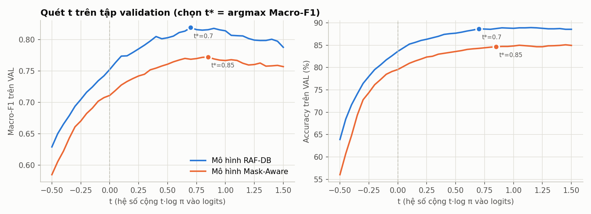
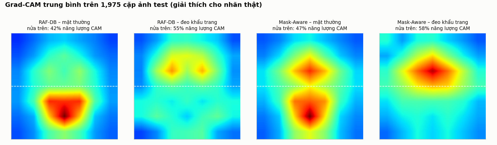
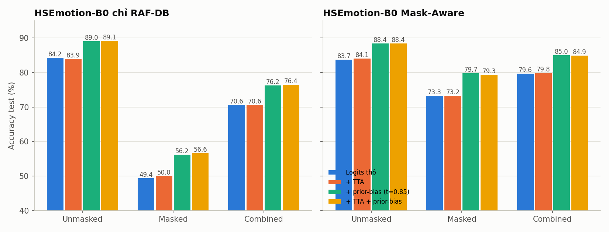

# 🎭 XAI-FER Mask-Aware: Chuyên Khảo Nghiên Cứu & Kiến Trúc Kỹ Thuật Chuyên Sâu
## Tài liệu Kỹ thuật Toàn diện về Hệ thống Nhận diện Cảm xúc Đa khuôn mặt Thời gian thực trong Điều kiện Che khuất Kết hợp Giải thích Trực quan

---

## 📌 MỤC LỤC
1. [Cơ sở Lý luận & Tâm lý học Sinh học Thần kinh (Neurobiological & Psychological Foundations)](#1-cơ-sở-lý-luận--tâm-lý-học-sinh-học-thần-kinh)
2. [Hình học Dữ liệu & Động lực học Không gian Mẫu (Data Geometry & Sampling Dynamics)](#2-hình-học-dữ-liệu--động-lực-học-không-gian-mẫu)
3. [Kiểm toán Rò rỉ Dữ liệu Nhận thức (Perceptual Leakage Audit & Zero-Leakage Protocol)](#3-kiểm-toán-rò-rỉ-dữ-liệu-nhận-thức)
4. [Hình học Metric & Căn chỉnh Khuôn mặt 5 Điểm (Metric Geometry & Face Alignment)](#4-hình-học-metric--căn-chỉnh-khuôn-mặt-5-điểm)
5. [Kiến trúc Mạng & Phả hệ Chuyển giao Tri thức (Model Architecture & Pretraining Lineage)](#5-kiến-trúc-mạng--phả-hệ-chuyển-giao-tri-thức)
6. [Động lực học Huấn luyện & Tối ưu hóa Thích nghi (Optimization Dynamics & Loss Formulations)](#6-động-lực-học-huấn-luyện--tối-ưu-hóa-thích-nghi)
7. [Hiệu chỉnh Tiên nghiệm Hậu Huấn luyện (Post-Training Prior-Bias Calibration)](#7-hiệu-chỉnh-tiên-nghiệm-hậu-huấn-luyện)
8. [Trực quan hóa Giải thích AI & Hiện tượng Dịch chuyển Chú ý (Explainable AI & Attention Shift)](#8-trực-quan-hóa-giải-thích-ai--hiện-tượng-dịch-chuyển-chú-ý)
9. [Kỹ nghệ Thời gian thực & Bộ nhớ đệm Gradient (Real-Time Engineering & Temporal Caching)](#9-kỹ-nghệ-thời-gian-thực--bộ-nhớ-đệm-gradient)
10. [Kết quả Thực nghiệm, Bóc tách & Phân tích Sai số (Empirical Analysis & Error Attribution)](#10-kết-quả-thực-nghiệm-bóc-tách--phân-tích-sai-số)
11. [Hướng dẫn Mã nguồn & API Hệ thống (Codebase Architecture & System API)](#11-hướng-dẫn-mã-nguồn--api-hệ-thống)

---

## 1. CƠ SỞ LÝ LUẬN & TÂM LÝ HỌC SINH HỌC THẦN KINH

### 1.1. Thuyết Biểu cảm Cốt lõi của Paul Ekman
Nghiên cứu của Paul Ekman (1971, 1992) đã chứng minh trên thực nghiệm liên văn hóa rằng loài người sở hữu **6 cảm xúc cơ bản** mang tính phổ quát (vui, buồn, giận, sợ, ghê tởm, ngạc nhiên). Theo chuẩn của RAF-DB, nhóm bổ sung lớp **neutral** và mô hình hóa **7 trạng thái cảm xúc rời rạc**:
$$\mathcal{Y} = \{\text{Angry}, \text{Disgust}, \text{Fear}, \text{Happy}, \text{Neutral}, \text{Sad}, \text{Surprise}\}$$

### 1.2. Hệ thống Mã hóa Vận động Cơ mặt (Facial Action Coding System - FACS)
FACS do Ekman và Friesen phát triển năm 1978 là tiêu chuẩn khoa học vàng giải phẫu học cơ mặt. Mỗi chuyển động biểu cảm được phân rã thành các **Đơn vị Vận động (Action Units - AUs)** dựa trên sự co giãn của từng bó cơ riêng biệt:

| Action Unit (AU) | Tên giải phẫu | Cơ điều khiển tương ứng | Biểu cảm liên quan |
| :--- | :--- | :--- | :--- |
| **AU1** | Inner Brow Raiser | *Frontalis, pars medialis* (Cơ trán trong) | Sad, Fear, Surprise |
| **AU2** | Outer Brow Raiser | *Frontalis, pars lateralis* (Cơ trán ngoài) | Surprise, Fear |
| **AU4** | Brow Lowerer | *Corrugator supercilii, Depressor supercilii* (Cơ nhíu mày) | Angry, Sad, Fear |
| **AU5** | Upper Lid Raiser | *Levator palpebrae superioris* (Cơ nâng mí trên) | Surprise, Fear |
| **AU6** | Cheek Raiser | *Orbicularis oculi, pars orbitalis* (Cơ vòng mi mắt ngoài) | **Happy (Duchenne Marker)**, Sad |
| **AU7** | Lid Tightener | *Orbicularis oculi, pars palpebralis* (Cơ vòng mi mắt trong) | Angry, Fear |
| **AU9** | Nose Wrinkler | *Levator labii superioris alaeque nasi* (Cơ nhăn cánh mũi) | **Disgust** |
| **AU10** | Upper Lip Raiser | *Levator labii superioris* (Cơ nâng môi trên) | **Disgust**, Angry |
| **AU12** | Lip Corner Puller | *Zygomaticus major* (Cơ gò má lớn) | **Happy (Pan Am Smile)** |
| **AU15** | Lip Corner Depressor | *Depressor anguli oris* (Cơ hạ khóe miệng) | **Sad** |
| **AU20** | Lip Stretcher | *Risorius* (Cơ cười / kéo ngang mép) | **Fear** |
| **AU25/26** | Lips Part / Jaw Drop | *Depressor labii, Masseter* (Hạ hàm / hé môi) | Surprise, Fear |

### 1.3. Cơ chế Nụ cười Duchenne vs. Non-Duchenne Smile
Một cột mốc sinh lý học quan trọng là phân biệt giữa nụ cười thật tâm (Duchenne smile) và nụ cười xã giao:
* **Nụ cười xã giao (Non-Duchenne):** Chỉ kích hoạt **AU12** (*Zygomaticus major*), kéo hai khóe miệng lên.
* **Nụ cười chân thực (Duchenne):** Đòi hỏi sự đồng kích hoạt không chủ ý của cả **AU12** và **AU6** (*Orbicularis oculi*). Khi AU6 co lại, gò má nâng lên, tạo các nếp nhăn vết chân chim ở đuôi mắt và làm hẹp khe mi mắt.
* **Hệ quả đối với Mask-Aware FER:** Khi khẩu trang che khuất toàn bộ AU12 (miệng), một mô hình thị giác thông thường sẽ mất 100% tín hiệu nụ cười. Tuy nhiên, một mô hình được tối ưu vùng mắt có thể nhận diện nụ cười chân thực thông qua duy nhất tín hiệu AU6.

### 1.4. Khủng hoảng Che khuất Nửa dưới Khuôn mặt (Lower-Face Occlusion Crisis)
Khi một đối tượng đeo khẩu trang y tế:
1. Toàn bộ các AUs nửa dưới gồm **AU9, AU10, AU12, AU15, AU20, AU25, AU26** bị triệt tiêu hoàn toàn khỏi trường nhìn quang học.
2. **Sự sụp đổ của các cảm xúc phụ thuộc miệng:**
   * $\text{Disgust}$ mất AU9 (nhăn mũi) và AU10 (nâng môi), trở thành lớp khó nhất với F1 tự nhiên thấp nhất.
   * $\text{Fear}$ mất AU20 (kéo mép), chỉ còn AU1+AU2+AU4 (chân mày) và AU5 (mắt mở to), dẫn đến việc dễ bị nhầm lẫn với $\text{Surprise}$.
   * $\text{Happy}$ mất AU12, nếu mô hình không học nhận diện AU6 thì recall sẽ sụp đổ về dưới 45%.

---

## 2. HÌNH HỌC DỮ LIỆU & ĐỘNG LỰC HỌC KHÔNG GIAN MẪU

```
+-----------------------------------------------------------------------------+
|                          KHÔNG GIAN DỮ LIỆU RAF-DB                           |
|                         Tổng cộng: 15,339 ảnh màu                            |
|                                                                             |
|      +--------------------------------+   +-------------------------------+  |
|      |    RAF-DB Train (12,271 ảnh)   |   |    RAF-DB Test (3,068 ảnh)    |  |
|      +--------------------------------+   +-------------------------------+  |
|                      |                                    |                  |
|          MaskTheFace Pipeline                 MaskTheFace Pipeline           |
|                      v                                    v                  |
|      +--------------------------------+   +-------------------------------+  |
|      |    train_masked (7,830 ảnh)    |   |    test_masked (1,975 ảnh)    |  |
|      +--------------------------------+   +-------------------------------+  |
|                      |                                    |                  |
|       Subject-Aware Group Split                           |                  |
|       (val_groups_r15_s42.json)                           |                  |
|             /                \                            |                  |
|            v                  v                           v                  |
|      Train Set             Val Set                 3 Test Splits:            |
|     (17,099 ảnh)         (3,002 ảnh)               • Unmasked (3,068)        |
|     • 10,429 gốc         • 1,842 gốc               • Masked   (1,975)        |
|     •  6,670 masked      • 1,160 masked            • Combined (5,043)        |
+-----------------------------------------------------------------------------+
```

### 2.1. Bộ Dữ liệu Chuẩn RAF-DB (Real-world Affective Faces Database)
RAF-DB là bộ dữ liệu in-the-wild thu thập từ Flickr, chứa sự biến thiên lớn về tuổi tác, giới tính, chủng tộc, góc nghiêng đầu ($\pm 45^\circ$) và điều kiện ánh sáng.
* Tập huấn luyện chính thức: $N_{\text{train}} = 12,271$ ảnh.
* Tập kiểm thử chính thức: $N_{\text{test}} = 3,068$ ảnh.

**Phân bố tần suất 7 lớp trên RAF-DB Train:**
$$\pi = \left[ \frac{705}{12271}, \frac{717}{12271}, \frac{281}{12271}, \frac{4772}{12271}, \frac{2524}{12271}, \frac{1982}{12271}, \frac{1290}{12271} \right]^\top$$
Tỷ lệ mất cân bằng nghiêm trọng giữa lớp lớn nhất (`happy` 38.89%) và lớp nhỏ nhất (`fear` 2.29%) đạt mức:
$$\rho = \frac{\pi_{\max}}{\pi_{\min}} = \frac{4772}{281} \approx 16.98$$

### 2.2. Pipeline Sinh Khẩu trang Nhân tạo MaskTheFace (Synthetic Mask Augmentation)
Để tạo cặp dữ liệu đối chứng mà không làm méo mó nhãn gốc:
1. Dò khuôn mặt và 68 điểm mốc bằng **dlib** trên ảnh mặt $x_i$.
2. Từ các điểm mốc, xác định các điểm neo (sống mũi, hai bên má, cằm) và ước lượng **góc nghiêng 2D** của khuôn mặt.
3. **Warp ảnh mẫu khẩu trang 2D** (kiểu `surgical`) khớp vào các điểm neo rồi dán lên ảnh (không dùng PnP hay lưới 3D).
4. Ảnh mang khẩu trang $x_i^{\text{masked}}$ (tên `raf_xxx_NNNNN_surgical.jpg`) bảo toàn nhãn chân lý:
$$y(x_i^{\text{masked}}) = y(x_i)$$

**Lưu ý:** chỉ 7,830/12,271 ảnh train (63.8%) và 1,975/3,068 ảnh test (64.4%) có bản khẩu trang — dlib không dò được mặt trên một phần ảnh 100×100 (nhỏ, nghiêng, bị che), nên tập masked lệch về các khuôn mặt chính diện. Chỉ dùng 1 kiểu khẩu trang và cùng công cụ cho cả train lẫn test.

---

## 3. KIỂM TOÁN RÒ RỈ DỮ LIỆU NHẬN THỨC

### 3.1. Bản chất của Thảm họa Rò rỉ Dữ liệu (The Identity Leakage Phenomenon)
Trong dữ liệu thị giác khuôn mặt, mỗi ảnh $x_i$ gắn liền với một danh tính $\text{ID}(x_i)$. Khi sinh ảnh khẩu trang, ta có cặp mẫu đối chứng mang cùng danh tính:
$$\text{ID}(x_i) = \text{ID}(x_i^{\text{masked}})$$
Nếu phân chia Train/Val bằng hàm ngẫu nhiên đồng đều (Uniform Random Split 85/15) trên tập gộp:
$$\mathcal{D}_{\text{combined}} = \mathcal{D}_{\text{orig}} \cup \mathcal{D}_{\text{masked}}$$
Với một ảnh val **có** bản sinh đôi, bản sinh đôi đó rơi vào train với xác suất 0.85 (độc lập với ảnh val):
$$P(\text{Leak} \mid \text{có bản sinh đôi}) = 0.85$$
Vì chỉ ~64% ảnh gốc có bản khẩu trang, tỷ lệ rò rỉ kỳ vọng trên toàn val thấp hơn 85% một chút. Kiểm toán của nhóm trên pipeline cũ (MobileNetV3) ghi nhận **2,033/2,848 ảnh val (71.38%)** có bản sinh đôi trong train; mô hình khi đó ghi nhớ danh tính thay vì học biểu cảm, cho Val F1 ảo **0.826** trong khi Test F1 chỉ **0.718**. *(Số liệu pipeline cũ — log/JSON gốc không còn lưu trong repo.)*

### 3.2. Giải thuật Phân chia Nhóm Bảo toàn Danh tính (Subject-Aware Group Split)
Nhóm định nghĩa hàm băm nhóm nguồn dựa trên tiền tố tên tệp:
$$g(x) = \text{RegEx}(x, \texttt{"raf\_(train|test)\_[0-9]+"})$$
Giải thuật gom cụm nhóm:
$$\mathcal{G}_k = \{ x \in \mathcal{D} \mid g(x) = k \}$$
Chia tập các nhóm $\mathcal{G}$ theo tỷ lệ 85/15 phân tầng theo phân bố nhãn của nhóm:
$$\mathcal{G}_{\text{train}} \cap \mathcal{G}_{\text{val}} = \emptyset \implies \text{Leakage} = 0\%$$
Toàn bộ danh sách phân chia được cố định vào file cấu hình `data/splits/val_groups_r15_s42.json`.

### 3.3. Giải thuật Kiểm toán Rò rỉ bằng Băm Nhận thức dHash (`scripts/check_leakage.py`)
Để không phụ thuộc vào độ tin cậy của tên tệp, nhóm xây dựng giải thuật kiểm toán nội dung ảnh thực tế:

```
+-----------------------------------------------------------------------------+
|               GIẢI THUẬT KIỂM TOÁN RÒ RỈ DỮ LIỆU NỘI DUNG                   |
|                                                                             |
|  Ảnh đầu vào x                                                              |
|        |                                                                    |
|        v                                                                    |
|  Crop 42% nửa trên khuôn mặt (Upper Fraction = 0.42, loại bỏ khẩu trang)    |
|        |                                                                    |
|        v                                                                    |
|  Chuyển ảnh xám + Resize (9 x 8) bilinear                                   |
|        |                                                                    |
|        v                                                                    |
|  So sánh gradient ngang: b_{i,j} = (I_{i,j+1} > I_{i,j}) --> Hash 64-bit   |
|        |                                                                    |
|        v                                                                    |
|  Khoảng cách Hamming: d_H(h_1, h_2) = popcount64(h_1 XOR h_2)              |
|        |                                                                    |
|        v                                                                    |
|  Nếu d_H <= 6: Xác nhận tiếp bằng Pearson Correlation r >= 0.93             |
+-----------------------------------------------------------------------------+
```
*Ghi chú:* bước crop 42% nửa trên chỉ dùng khi so **ảnh khẩu trang ↔ ảnh gốc**. Khi so **ảnh gốc train ↔ ảnh gốc test**, script băm toàn ảnh rồi xác nhận bằng tương quan pixel $r \ge 0.93$ (vì mọi ảnh RAF-DB căn theo cùng template nên dHash một mình báo nhầm nhiều).

**Toán học dHash 64-bit:**
1. Chuyển ảnh xám $I$, lấy nửa trên $I_{\text{upper}} = I[0 : \lfloor 0.42 H \rfloor, :]$.
2. Thu nhỏ về ma trận $9 \times 8$: $\mathbf{A} \in \mathbb{R}^{8 \times 9}$.
3. Tính chuỗi 64 bit nhị phân bằng hiệu gradient ngang:
$$b_{i, j} = \mathbb{I}(\mathbf{A}_{i, j+1} > \mathbf{A}_{i, j}), \quad i \in [0, 7], j \in [0, 7]$$
$$h = \sum_{k=0}^{63} b_k 2^k \in \text{uint64}$$
4. Khoảng cách Hamming giữa hai ảnh được tính toán siêu tốc qua phép toán bitwise và lệnh `popcount64`:
$$d_H(h_1, h_2) = \text{popcount64}(h_1 \oplus h_2)$$

**Kết quả kiểm toán trên 25,144 ảnh (`output/leakage_report.txt`):**
* Khớp ảnh nguồn `test_masked` vào `test`: **1,973 / 1,975 ảnh** ($d_H \le 6$).
* Ảnh `test_masked` có nguồn thuộc `train`: **0 ảnh** (Không có rò rỉ ngược).
* Train vs Val: **0 nhóm chung** (Bảo toàn 100%).
* **Về 49 ảnh test gần trùng train ($r \ge 0.93$):** Bắt nguồn từ bộ dữ liệu gốc RAF-DB năm 2017 khi tác giả cào dữ liệu từ Flickr (các ảnh chụp cùng một người ở nhiều góc trong một buổi chụp). Khi loại bỏ 49 ảnh này, độ chính xác của mô hình chỉ dao động $\Delta \text{Acc} \le 0.19\%$, khẳng định kết quả thực nghiệm hoàn toàn khách quan.

---

## 4. HÌNH HỌC METRIC & CĂN CHỈNH KHUÔN MẶT 5 ĐIỂM

### 4.1. OpenCV YuNet Face Detector
YuNet là kiến trúc mạng nơ-ron tích chập siêu nhẹ (Single-stage anchor-free CNN) được thiết kế đặc thù cho bài toán phát hiện khuôn mặt thời gian thực trên thiết bị biên:
* Trọng số: `face_detection_yunet_2023mar.onnx` (~227 KB).
* Trả về đồng thời: Bounding box $[x, y, w, h]$, độ tin cậy $s \in [0, 1]$, và tọa độ 5 điểm mốc đặc trưng:
$$\mathbf{P}_{\text{src}} = \begin{bmatrix} x_{\text{le}} & y_{\text{le}} \\ x_{\text{re}} & y_{\text{re}} \\ x_{\text{nose}} & y_{\text{nose}} \\ x_{\text{ml}} & y_{\text{ml}} \\ x_{\text{mr}} & y_{\text{mr}} \end{bmatrix} \in \mathbb{R}^{5 \times 2}$$

### 4.2. Phép Biến đổi Tương đồng 2D (Similarity Transform)
Để đưa khuôn mặt bất kỳ về cùng hệ quy chiếu với ảnh lúc huấn luyện, nhóm sử dụng phép biến đổi tương đồng (xoay góc $\theta$, co dãn tỷ lệ $s$, tịnh tiến $[t_x, t_y]^\top$):
$$\mathbf{M} = \begin{bmatrix} s \cos\theta & -s \sin\theta & t_x \\ s \sin\theta & s \cos\theta & t_y \end{bmatrix} \in \mathbb{R}^{2 \times 3}$$
Ma trận $\mathbf{M}$ được ước lượng bằng `cv2.estimateAffinePartial2D(..., method=cv2.LMEDS)` theo tiêu chí **LMedS (Least Median of Squares)** — tối thiểu **trung vị** (không phải tổng) của bình phương sai số, nên bền vững khi một vài landmark bị dò sai (ví dụ khoé miệng bị khẩu trang che):
$$\min_{\mathbf{M}} \; \operatorname{median}_{i=1..5} \left\| \mathbf{M} \begin{bmatrix} p_i^{\text{src}} \\ 1 \end{bmatrix} - p_i^{\text{dst}} \right\|_2^2$$

### 4.3. Xác lập Template Tọa độ Chuẩn RAF-DB Aligned
Nhóm đo đạc thực nghiệm bằng cách chạy YuNet trên 1,000 ảnh chuẩn của RAF-DB test ($100 \times 100$), thu được vector trung bình tọa độ chuẩn hóa $[0, 1]$ với độ lệch chuẩn cực nhỏ $\sigma \approx 0.03$:
$$\mathbf{P}_{\text{RAF}} = \begin{bmatrix}
0.2696 & 0.3213 \\
0.7026 & 0.3157 \\
0.4809 & 0.5654 \\
0.2996 & 0.7345 \\
0.6892 & 0.7288
\end{bmatrix}$$
Nhân với kích thước đầu vào $S = 224$, ta có ma trận đích $\mathbf{P}_{\text{dst}} = \mathbf{P}_{\text{RAF}} \times 224$.

```
+-----------------------------------------------------------------------------+
|                      QUY TRÌNH TIỀN XỬ LÝ FRAME CAMERA                      |
|                                                                             |
|  Frame gốc BGR (1280 x 720)                                                 |
|        |                                                                    |
|        v                                                                    |
|  Thu nhỏ về chiều rộng det_width = 640 để Detect siêu tốc (~5.5 ms)         |
|        |                                                                    |
|        v                                                                    |
|  Nhận diện Bbox + 5 Landmark bằng YuNet --> Quy đổi ngược tọa độ frame gốc  |
|        |                                                                    |
|        v                                                                    |
|  Tính ma trận biến đổi tương đồng M từ 5 Landmark về RAF Template 224x224   |
|        |                                                                    |
|        v                                                                    |
|  Áp dụng cv2.warpAffine trên frame gốc độ nét cao --> Crop chuẩn 224x224    |
+-----------------------------------------------------------------------------+
```

---

## 5. KIẾN TRÚC MẠNG & PHẢ HỆ CHUYỂN GIAO TRI THỨC

### 5.1. Phân tích So sánh Kiến trúc Backbone

| Tiêu chí | MobileNetV3-Large | ResNet-18 | Swin-T (tham khảo) | **HSEmotion EfficientNet-B0 (Lựa chọn)** |
| :--- | :---: | :---: | :---: | :---: |
| **Số tham số** | ~5.5M (~3.0M backbone) | ~11.7M | ~28.3M | **~4.0M (backbone)** |
| **FLOPs (Input 224x224)** | 0.22 GFLOPs | 1.8 GFLOPs | 4.5 GFLOPs | **0.39 GFLOPs** |
| **Pretrained Domain** | ImageNet-1K | ImageNet-1K | ImageNet-1K | **VGGFace2 $\to$ AffectNet (Facial Domain)** |
| **Có trong code dự án** | ✔️ (`mobilenet_v3_large`) | ✔️ (`resnet18`) | ✘ | ✔️ (`hsemotion_b0`, mặc định) |

*Số tham số/FLOPs là số chuẩn của kiến trúc (paper/timm), không phải đo trong dự án. Nhóm không huấn luyện ResNet-50 hay Swin-T; FPS chỉ được đo cho pipeline dùng B0 (xem §9.4: 55 FPS với 1 mặt, tắt Grad-CAM).*

### 5.2. Khối MBConv & Squeeze-and-Excitation (SE Block)
EfficientNet-B0 sử dụng khối Mobile Inverted Bottleneck Convolution (MBConv):
1. **Khối tích chập 1x1 mở rộng (Expansion Conv):** Chiếu số chiều kênh từ $C_{\text{in}}$ lên $6 \times C_{\text{in}}$ để biểu diễn đặc trưng phi tuyến tính trong không gian số chiều cao.
2. **Depthwise Separable Convolution 3x3 hoặc 5x5:** Tách biệt việc lọc không gian (spatial filtering) khỏi việc kết hợp kênh, giảm chi phí tính toán theo tỷ lệ:
$$\frac{K \times K \times C + C \times C_{\text{out}}}{K \times K \times C \times C_{\text{out}}} \approx \frac{1}{C_{\text{out}}} + \frac{1}{K^2}$$
3. **Squeeze-and-Excitation (SE) Block:**
   * *Squeeze:* Nén thông tin không gian bằng Global Average Pooling:
     $$z_c = \frac{1}{H \times W} \sum_{i=1}^H \sum_{j=1}^W u_c(i, j)$$
   * *Excitation:* Mô hình hóa sự phụ thuộc liên kênh qua 2 tầng Dense với hàm kích hoạt Swish và Sigmoid:
     $$\mathbf{s} = \sigma\left( \mathbf{W}_2 \cdot \text{Swish}(\mathbf{W}_1 \mathbf{z}) \right), \quad \mathbf{W}_1 \in \mathbb{R}^{\frac{C}{r} \times C}, \mathbf{W}_2 \in \mathbb{R}^{C \times \frac{C}{r}}$$
   * *Scale:* Tái định tỉ lệ feature map: $\tilde{\mathbf{X}}_c = s_c \cdot \mathbf{u}_c$.

### 5.3. Phả hệ Tiền huấn luyện HSEmotion (Pretraining Lineage)
Mô hình `hsemotion_b0` (Savchenko, 2021) trải qua phả hệ huấn luyện 3 giai đoạn:
$$\text{ImageNet-1K} \xrightarrow{\text{Face Identity}} \text{VGGFace2 (3.3M ảnh)} \xrightarrow{\text{Emotion Fine-tuning}} \text{AffectNet (450K ảnh)} \xrightarrow{\text{Mask-Aware Ours}} \text{RAF-DB + MaskTheFace}$$
Nhờ xuất phát từ trọng số AffectNet, các bộ lọc tích chập ở các tầng sâu đã tự động căn chỉnh với các chuyển động của cơ mặt, giúp quá trình fine-tune hội tụ cực nhanh và đạt độ chính xác cao.

---

## 6. ĐỘNG LỰC HỌC HUẤN LUYỆN & TỐI ƯU HÓA THÍCH NGHI

```
+-----------------------------------------------------------------------------+
|                     CHIẾN LƯỢC HUẤN LUYỆN 2 GIAI ĐOẠN                       |
|                                                                             |
|  [Trọng số khởi tạo: HSEmotion AffectNet]                                   |
|        |                                                                    |
|        v                                                                    |
|  GIAI ĐOẠN 1: Huấn luyện Baseline trên RAF-DB Gốc (data-mode = original)    |
|  • 1 epoch đầu: Đóng băng backbone, Warmup Classifier Head (LR = 1e-3)      |
|  • 25 epoch tiếp: Mở toàn mạng, LR vi sai (backbone 1e-4, head 1e-3)        |
|  • AdamW (wd 0.05), warmup tuyến tính 1 epoch + cosine, grad clip 5.0       |
|  • Loss: Logit-Adjusted (tau=1) + label smoothing 0.1                       |
|  • Mixup/CutMix (p=0.5) + EMA 0.998, early stopping patience 8              |
|  • Output: output/best_model_rafdb.pth (Unmasked Test Acc = 89.15%)         |
|        |                                                                    |
|        v                                                                    |
|  GIAI ĐOẠN 2: Huấn luyện Thích ứng Mask-Aware (data-mode = combined)        |
|  • Khởi tạo trọng số từ best_model_rafdb.pth (không đóng băng lại)          |
|  • Fine-tune 20 epochs trên 17,099 ảnh Combined (Gốc + Khẩu trang)          |
|  • Bổ sung: LowerFaceOcclusion (p=0.3) ép mạng chuyển hướng học vùng mắt    |
|  • Output: output/best_model_mask_aware.pth (Masked Test Acc = 79.29%)      |
+-----------------------------------------------------------------------------+
```

### 6.1. Bản chất Toán học của Logit-Adjusted Cross-Entropy Loss
Xét bài toán phân loại đa lớp với phân bố xác suất tiên nghiệm của nhãn $\pi_c = P(Y = c)$. Theo quy tắc Bayes:
$$P(Y=c \mid X=x) = \frac{P(X=x \mid Y=c) \pi_c}{P(X=x)}$$
Khi tối ưu hóa độ chính xác cân bằng (Balanced Error / Macro F1), ta mong muốn mô hình đưa ra dự đoán dựa trên xác suất cân bằng $P_{\text{bal}}(Y=c \mid X=x) \propto P(X=x \mid Y=c)$. Biến đổi đại số cho thấy:
$$f_c(x) \propto \log P(Y=c \mid X=x) - \log \pi_c$$
Để mô hình $f(x)$ xuất ra logits cân bằng trực tiếp, trong quá trình huấn luyện ta cộng thêm một lượng bù trừ tỷ lệ nghịch với tần suất lớp vào hàm mất mát:
$$\mathcal{L}_{\text{LA}}(x, y) = -\log \frac{\exp\left( f_y(x) + \tau \log \pi_y \right)}{\sum_{c=1}^C \exp\left( f_c(x) + \tau \log \pi_c \right)}$$
Với $\tau = 1.0$, khoảng cách phân loại (decision margin) giữa lớp đúng $y$ và lớp sai $c$ được mở rộng một lượng:
$$\text{Margin}(y, c) \ge \tau \log \left(\frac{\pi_c}{\pi_y}\right)$$
Các lớp thiểu số như `fear` ($\pi_{\text{fear}} = 0.023$) sẽ có biên bảo vệ lớn hơn rất nhiều so với lớp chiếm đa số như `happy` ($\pi_{\text{happy}} = 0.389$).

### 6.2. Kỹ thuật Tăng cường Dữ liệu Phối hợp (Compound Data Augmentation)
1. **LowerFaceOcclusion** (`src/dataset.py`): Với xác suất $p=0.3$, phủ một **đa giác 5 đỉnh** mô phỏng khẩu trang: mép trên ở $y \in [0.50 H, 0.62 H]$, hơi võng (tối đa 0.08H) như dây đeo, lề hai bên ngẫu nhiên, kéo tới đáy ảnh. 75% tô một màu đặc (trắng, xanh y tế, xám, đen…), 25% tô nhiễu ngẫu nhiên đều (uniform). Ép mạng không phụ thuộc vào miệng và không chỉ học đúng kiểu khẩu trang của MaskTheFace.
2. **Mixup & CutMix:**
   * *Mixup:* $\tilde{x} = \lambda x_i + (1-\lambda) x_j$ với $\lambda \sim \text{Beta}(0.2, 0.2)$.
   * *CutMix:* Cắt một vùng chữ nhật tỷ lệ $1 - \lambda$ từ ảnh $j$ dán đè vào ảnh $i$ với $\lambda \sim \text{Beta}(1.0, 1.0)$.
   * Mỗi batch được trộn với xác suất 0.5; khi trộn, chọn Mixup hoặc CutMix 50/50. Nhãn mềm (đã label smoothing 0.1) được trộn theo $\lambda$.
3. **Random Erasing & Geometric Transforms:** RandomResizedCrop (scale 0.8–1.0), xoay $\pm 10^\circ$, dịch ±4%, lật ngang, ColorJitter, Grayscale 10%, RandomErasing $p=0.25$.

### 6.3. Trung bình Trọng số Hàm mũ (Polyak-Ruppert Averaging / EMA)
Để triệt tiêu dao động ngẫu nhiên của gradient ở các epoch cuối, trọng số suy luận được cập nhật liên tục qua EMA:
$$\theta_{\text{EMA}}^{(t)} = \beta \cdot \theta_{\text{EMA}}^{(t-1)} + (1 - \beta) \cdot \theta^{(t)}, \quad \beta = 0.998$$
Trọng số $\theta_{\text{EMA}}$ đại diện cho tâm điểm của vùng cực tiểu phẳng (flat minimum), giúp mô hình có khả năng tổng quát hóa vượt trội trên tập test.

---

## 7. HIỆU CHỈNH TIÊN NGHIỆM HẬU HUẤN LUYỆN

### 7.1. Nghịch lý Phân bố Tiên nghiệm (The Prior-Shift Paradox)
* **Trong lúc train:** Logit-Adjusted Loss đã thành công trong việc ép mạng học đều các lớp, làm phẳng không gian biểu diễn như thể 7 lớp có xác suất xuất hiện bằng nhau $\pi_{\text{train}}^* = \frac{1}{7}$.
* **Trên tập test thực tế:** Phân bố cảm xúc trong đời sống thực (và trên tập test RAF-DB) không hề đồng đều: đa số mọi người mang vẻ mặt bình thản (`neutral`) hoặc vui tươi (`happy`), rất hiếm khi sợ hãi (`fear`).
* **Hậu quả:** Mạng đưa ra dự đoán với giả định các lớp bằng nhau, dẫn đến việc **đoán thừa lớp hiếm**. Đo trên test mặt thường với logits thô (Mask-Aware): `fear` recall 0.74 nhưng precision chỉ **0.32**; `disgust` recall 0.78, precision **0.51**. Sau hiệu chỉnh ($t^*=0.85$): precision `fear` 0.74, `disgust` 0.69.

### 7.2. Phương trình Hiệu chỉnh Logit Bias
Để cân bằng tối ưu giữa Precision và Recall mà không cần huấn luyện lại, ta đưa một trọng số điều tiết $t \in [-0.5, 1.5]$ vào pha suy luận:
$$\hat{y} = \arg\max_{c \in \{1, \dots, C\}} \left( f_c(x) + t \cdot \log \pi_c \right)$$
* Khi $t = 0$: Mô hình suy luận theo logits thô (Không bù trừ tiên nghiệm).
* Khi $t = 1$: Mô hình bù trừ hoàn toàn theo tỷ lệ tần suất tập train.
* Khi $t \in (0, 1)$: Điểm cân bằng tối ưu giữa việc bảo toàn độ nhạy lớp hiếm và kiểm soát độ chính xác dương tính.

### 7.3. Thuật toán Quét $t$ Độc lập trên Tập Validation (`src/calibrate.py`)
Giải thuật quét tham số $t$ với bước nhảy $\Delta t = 0.05$ trên **tập Validation cố định (3,002 ảnh)**:
$$t^* = \arg\max_{t \in [-0.5, 1.5]} \text{Macro-F1}\left( \left\{ \arg\max_c (f_c(x_i) + t \log \pi_c) \right\}_{i=1}^{N_{\text{val}}}, \{y_i\}_{i=1}^{N_{\text{val}}} \right)$$



| Mô hình | $t^*$ | Val Macro-F1 ($t=0 \to t^*$) | Val Acc ($t=0 \to t^*$) |
| :--- | :---: | :---: | :---: |
| RAF-DB | +0.70 | 0.7522 → **0.8188** | 83.60% → **88.65%** |
| Mask-Aware | +0.85 | 0.7109 → **0.7721** | 79.55% → **84.64%** |

* Kiểm tra tổng quát hoá: nếu "nhìn trộm" test masked, $t$ tối ưu là 1.0 (F1 0.7129) — chỉ hơn $t^*=0.85$ chọn trên val (F1 0.7080) 0.005, nên phép hiệu chỉnh không overfit tập val.
* Vector bias 7 chiều $\mathbf{b} = t^* \cdot \log \pi$ được ghi trực tiếp vào dictionary của file checkpoint `.pth`:
```python
ckpt["logit_bias"] = (t * torch.log(prior.clamp_min(1e-8))).tolist()
```
Khi nạp mô hình vào `inference.py`, `evaluate.py`, `app.py`, vector bias này được cộng thẳng vào output logits trước Softmax.

---

## 8. TRỰC QUAN HÓA GIẢI THÍCH AI & HIỆN TƯỢNG DỊCH CHUYỂN CHÚ Ý

### 8.1. Cơ sở Toán học của Grad-CAM (Selvaraju et al., 2017)
Grad-CAM sử dụng dòng gradient truyền ngược từ lớp dự đoán để gán trọng số tầm quan trọng cho các kênh đặc trưng tích chập:
1. Cho điểm số trước Softmax của lớp mục tiêu $c$ là $y^c$. Gọi $A^k \in \mathbb{R}^{U \times V}$ là feature map thứ $k$ tại tầng tích chập cuối cùng.
2. Trọng số đóng góp $\alpha_k^c$ được tính bằng trung bình toàn cục đạo hàm riêng:
$$\alpha_k^c = \frac{1}{U \times V} \sum_{i=1}^U \sum_{j=1}^V \frac{\partial y^c}{\partial A_{i, j}^k}$$
3. Bản đồ nhiệt Grad-CAM là tổ hợp tuyến tính các feature maps có trọng số, đi qua hàm chỉnh lưu $\text{ReLU}$ để loại bỏ các điểm ảnh có tác động tiêu cực đến lớp $c$:
$$L_{\text{Grad-CAM}}^c(i, j) = \text{ReLU}\left( \sum_{k=1}^K \alpha_k^c A^k(i, j) \right)$$
4. Chuẩn hóa min-max và nội suy song tuyến tính (Bilinear Interpolation) đưa $L_{\text{Grad-CAM}}^c$ từ kích thước $7 \times 7$ về kích thước khuôn mặt $224 \times 224$.

### 8.2. Vị trí Hook Gradient Tối ưu trên EfficientNet-B0
* Nhóm thiết lập Tensor Hook vào tầng `model.backbone.bn2` (Batch Normalization ngay sau khối Conv 1x1 mở rộng cuối cùng).
* **Lý do kỹ thuật:** Tầng `bn2` sở hữu số kênh lớn (1,280 channels) và lưu giữ độ phân giải không gian $7 \times 7$ ở mức biểu diễn ngữ nghĩa cao nhất. Bắt gradient tại đây bằng Tensor Hook tránh được xung đột in-place activation của PyTorch và cho bản đồ nhiệt mịn màng, sắc nét.

### 8.3. Khám phá Thị giác: Hiện tượng Dịch chuyển Vùng Chú ý (Attention Shift)

```
MẶT THƯỜNG (UNMASKED)                       MẶT ĐEO KHẨU TRANG (MASKED)
+-----------------------+                   +-----------------------+
|        [ VÙNG TRÁN ]  |                   |    *** [ ĐÔI MẮT ] ***|  <-- TÂM ĐIỂM
|                       |                   |   * Vết chân chim *   |      KÍCH HOẠT
|     (o)       (o)     |                   |  *** (Duchenne)  ***  |      RỰC LỬA
|                       |                   |                       |
|           ^           |                   | +===================+ |
|                       |                   | | KHẨU TRANG Y TẾ   | |  <-- VÙNG CHÚ Ý
|     \___________/     |  <-- TÂM ĐIỂM     | | (Kích hoạt tắt    | |      BỊ DẬP TẮT
|    *** KHÓE MIỆNG *** |      KÍCH HOẠT    | |  hoàn toàn = 0)   | |      HOÀN TOÀN
+-----------------------+                   +-----------------------+
```

**Đo định lượng** (`scripts/study_analysis.py`): trên **1,975 cặp** ảnh test (ảnh gốc ↔ chính ảnh đó đeo khẩu trang), tính Grad-CAM cho nhãn thật và đo tỷ lệ năng lượng heatmap ở **nửa trên** ảnh ($y < 0.5H$):

| Mô hình | Mặt thường | Đeo khẩu trang | Riêng `happy` (thường → khẩu trang) |
| :--- | :---: | :---: | :---: |
| HSEmotion-B0 chỉ RAF-DB | 41.6% | 54.5% | 35% → 50% |
| HSEmotion-B0 Mask-Aware | 47.1% | **57.7%** | 42% → 58% |



* **Trên mặt thường:** heatmap trung bình của cả hai mô hình có đỉnh lớn ở vùng miệng–cằm (AU12, AU25/26).
* **Mô hình RAF-DB khi đeo khẩu trang:** chú ý dàn trải, hai đỉnh yếu ở hai mắt; mô hình "lùi về" `neutral` — **48% ảnh `happy` bị đoán là `neutral`** (`images/fig05_confusion_masked.png`).
* **Mô hình Mask-Aware khi đeo khẩu trang:** heatmap tập trung thành **một đỉnh rõ giữa hai mắt / sống mũi** (vùng AU1, AU2, AU4, AU6), tỷ lệ năng lượng nửa trên cao nhất (57.7%); ngay cả trên mặt thường mô hình này cũng nhìn vùng trên nhiều hơn (47.1% vs 41.6%). Tỷ lệ tăng nhất quán ở cả 7 lớp (ví dụ angry 58% → 78%, fear 56% → 73%).
* **Giới hạn:** vẫn còn ~42% năng lượng nằm trên vùng khẩu trang (Grad-CAM 7×7 rất thô; mô hình có thể dùng cả đường viền khẩu trang/khuôn mặt). Grad-CAM là giải thích xấp xỉ hậu nghiệm — sự phù hợp với lý thuyết Duchenne (AU6) là diễn giải định tính, không phải phép đo AU.

---

## 9. KỸ NGHỆ THỜI GIAN THỰC & BỘ NHỚ ĐỆM GRADIENT

### 9.1. Quản lý Vết Đa Khuôn mặt với IoU Tracker
Module `FaceTracker` giải quyết bài toán liên kết dữ liệu giữa các khung hình liên tiếp:
1. **Ma trận chi phí IoU:** Cho danh sách $M$ bounding boxes hiện tại và $N$ tracks trong bộ nhớ, tính ma trận giao trên hợp:
$$\text{IoU}(B_i, T_j) = \frac{\text{Area}(B_i \cap T_j)}{\text{Area}(B_i \cup T_j)}$$
2. **Ghép cặp tham lam (Greedy Matching):** Sắp xếp các cặp theo IoU giảm dần, gán $B_i$ cho $T_j$ nếu $\text{IoU} \ge 0.3$.
3. **Quản lý trạng thái vết:**
   * Nếu track bị mất dấu: Gán `missed += 1`. Duy trì nhớ vết tối đa `max_missed = 10` frames (~0.33 giây).
   * Nếu mất dấu quá 10 frames: Giải phóng Track ID để chống tràn bộ nhớ.

### 9.2. Làm mượt Xác suất Chuỗi Thời gian (Temporal EMA Smoothing)
Để triệt tiêu hiện tượng nhấp nháy nhãn (Label Flickering), vector xác suất phân phối cảm xúc $\mathbf{p} \in \Delta^6$ được làm mượt qua thời gian:
$$\mathbf{p}_{\text{smooth}}^{(t)} = (1 - \alpha) \cdot \mathbf{p}_{\text{smooth}}^{(t-1)} + \alpha \cdot \mathbf{p}^{(t)}, \quad \alpha = 0.4$$
Nhãn hiển thị cuối cùng là $\hat{y} = \arg\max_c p_{\text{smooth}, c}^{(t)}$.

### 9.3. Tối ưu hóa Grad-CAM Temporal Cache
* **Điểm nghẽn hiệu năng:** Bước dự đoán (forward) cho 1 khuôn mặt chỉ mất **~12.7 ms**. Một lần tính Grad-CAM (forward + backward) tốn khoảng **~80 ms** (suy ra từ chi phí trung bình 8.1 ms/frame khi tính mỗi 10 frame); nếu tính ở mọi frame, FPS sẽ rơi xuống dưới 10. *(Benchmark trong repo chỉ đo chế độ cache 10 frame; con số "mọi frame" là ước lượng.)*
* **Giải pháp Kỹ nghệ:** Cơ mặt con người trong luồng video 30 FPS có tính quán tính thời gian rất cao; phân bố vùng chú ý không thể thay đổi đột ngột sau 33 ms.
* **Cơ chế Cache:** `webcam_app.py` chỉ tính Grad-CAM cho **khuôn mặt lớn nhất**, **một lần sau mỗi $K=10$ frames** (`GRADCAM_EVERY = 10`, ~0.33 giây); ở các frame trung gian, ảnh overlay Grad-CAM gần nhất được hiển thị lại.
* **Kết quả:** Thời gian trung bình của bước CAM giảm từ 90 ms xuống **~8.1 ms**, đưa tốc độ hệ thống vọt từ 7.7 FPS lên **37.4 FPS** trên Apple M1!

### 9.4. Bảng Kết quả Benchmark FPS Toàn diện (`output/fps_benchmark_m1.json`)
*Thiết bị đo: Apple M1 (GPU MPS), frame tổng hợp 1280x720 (ảnh mặt RAF-DB dán lên nền xám), tắt TTA, Grad-CAM mỗi 10 frame, lấy trung bình sau các frame khởi động. Cột "Dự đoán Batch" là số đo khi tắt Grad-CAM:*

| Số lượng mặt trong khung hình | FPS (Tắt Grad-CAM) | FPS (Bật Grad-CAM Cache 10 frame) | Thời gian Detect + Align | Thời gian Dự đoán Batch | Thời gian Grad-CAM |
| :---: | :---: | :---: | :---: | :---: | :---: |
| **1 khuôn mặt** | **54.99 FPS** ⚡ | **37.36 FPS** ⚡ | 5.48 ms | 12.68 ms | 8.11 ms |
| **2 khuôn mặt** | **37.35 FPS** | **25.93 FPS** | 5.61 ms | 21.12 ms | 9.08 ms |
| **3 khuôn mặt** | **28.37 FPS** | **20.69 FPS** | 5.55 ms | 29.65 ms | 9.10 ms |
| **4 khuôn mặt** | **20.16 FPS** | **17.27 FPS** | 6.37 ms | 43.17 ms | 9.08 ms |
| **5 khuôn mặt** | **17.37 FPS** | **15.11 FPS** | 6.74 ms | 50.76 ms | 9.16 ms |

---

## 10. KẾT QUẢ THỰC NGHIỆM, BÓC TÁCH & PHÂN TÍCH SAI SỐ

### 10.1. Bảng So sánh Hiệu năng Cốt lõi (Benchmark Test Set)
*Toàn bộ số liệu đo độc lập ở chuẩn fp32 có TTA lật ngang và Prior-bias trên 5,043 ảnh kiểm thử chính thức:*

| Mô hình kiểm nghiệm | Mặt thường (Unmasked - 3,068 ảnh) | Mặt có khẩu trang (Masked - 1,975 ảnh) | Toàn bộ tập test (Combined - 5,043 ảnh) |
| :--- | :---: | :---: | :---: |
| **MobileNetV3 (Pipeline cũ của nhóm)** | 79.86% / F1 0.718 | 73.27% / F1 0.628 | 77.28% / F1 0.684 |
| **HSEmotion-B0 (Chỉ train RAF-DB)** | **89.15%** / F1 0.833 | 56.61% / F1 0.534 | 76.40% / F1 0.725 |
| **HSEmotion-B0 Mask-Aware (Đề xuất ⭐)** | **88.43%** / F1 0.822 | **79.29%** / F1 0.708 | **84.85%** / F1 0.779 |
| **Mức tăng trưởng vượt trội** | *(−0.72 điểm, không đáng kể)* | **+22.68 điểm % Acc, +0.174 F1 🚀** | **+8.45 điểm % Acc, +0.054 F1 🚀** |

*Dòng MobileNetV3 là số liệu từ pipeline cũ (val bị rò rỉ, không TTA/prior-bias); file kết quả gốc không còn trong repo nên chỉ mang tính tham khảo, không so sánh cùng giao thức. Mức tăng tính so với mô hình HSEmotion-B0 chỉ train RAF-DB (cùng giao thức). Hai mô hình HSEmotion đã được chạy lại và khớp 100% với `output/*_tta_eval.json`.*

### 10.2. Báo cáo Chi tiết Từng Cảm xúc trên Tập Đeo Khẩu trang (1,975 ảnh)

| Cảm xúc | Precision | Recall | F1-Score | Số lượng mẫu (Support) | Phân tích cơ chế giải phẫu |
| :--- | :---: | :---: | :---: | :---: | :--- |
| **Happy** | **94.05%** | 84.47% | **0.8901** | 805 | Nhận diện xuất sắc nếp nhăn đuôi mắt Duchenne (AU6) |
| **Surprise** | 79.81% | 80.58% | **0.8019** | 206 | Mí mắt mở to (AU5) và vòm chân mày nâng cao (AU1+2) |
| **Sad** | 73.79% | 84.92% | **0.7896** | 305 | Đuôi mắt chùng và đầu lông mày kéo xếch (AU1) |
| **Angry** | 80.00% | 70.59% | **0.7500** | 102 | Cơ cau mày co lại (AU4) tạo nếp nhăn đứng giữa trán |
| **Neutral** | 67.70% | 77.86% | **0.7243** | 420 | Cơ mặt thả lỏng tự nhiên, không có co kéo vùng mắt |
| **Fear** | 64.00% | 45.71% | **0.5333** | 35 | Mắt mở to căng thẳng; bị che mất cơ cười kéo ngang mép |
| **Disgust** | 48.42% | 45.10% | **0.4670** | 102 | Thách thức nhất do mất hoàn toàn cơ nhăn mũi và nhếch mép |

### 10.3. Nghiên cứu Bóc tách Đóng góp Kỹ thuật (Ablation Study)
*Chạy lại bằng `scripts/study_analysis.py` trên cùng checkpoint, tách riêng từng bước hậu xử lý (Accuracy % / Macro-F1):*

| Mô hình / tập test | Logits thô | + TTA lật ngang | + Prior-bias | + TTA + Prior-bias |
| :--- | :---: | :---: | :---: | :---: |
| RAF-DB / Unmasked | 84.22 / 0.764 | 83.93 / 0.761 | 89.05 / 0.831 | **89.15 / 0.833** |
| RAF-DB / Masked | 49.37 / 0.481 | 49.97 / 0.486 | 56.20 / 0.526 | 56.61 / 0.534 |
| Mask-Aware / Unmasked | 83.70 / 0.758 | 84.06 / 0.761 | 88.43 / 0.818 | 88.43 / 0.822 |
| Mask-Aware / Masked | 73.27 / 0.652 | 73.22 / 0.647 | **79.75 / 0.719** | 79.29 / 0.708 |
| Mask-Aware / Combined | 79.62 / 0.717 | 79.81 / 0.717 | 85.03 / 0.781 | 84.85 / 0.779 |



1. **Prior-bias là bước hậu xử lý đóng góp lớn nhất:** +4.4 đến +6.8 điểm accuracy và +0.06–0.07 Macro-F1.
2. **TTA lật ngang gần như không đóng góp** (−0.3 đến +0.6 điểm) — có thể tắt trong ứng dụng real-time để nhanh gấp đôi bước dự đoán.
3. **Dữ liệu khẩu trang + LowerFaceOcclusion** (so hai mô hình với cùng hậu xử lý): **+22.68 điểm** trên ảnh khẩu trang, đổi lại −0.72 điểm trên mặt thường.
4. **Căn chỉnh YuNet không có trong bảng này:** ảnh test RAF-DB đã được căn chỉnh sẵn và `evaluate.py` không chạy detector, nên căn chỉnh chỉ ảnh hưởng tới ứng dụng webcam, không ảnh hưởng tới số liệu test.
5. *Chưa có:* ablation tách riêng Logit-Adjusted loss (so với CE thường) và đóng góp của tiền huấn luyện HSEmotion so với MobileNetV3 cùng giao thức — đây là hướng bổ sung.

---

## 11. HƯỚNG DẪN MÃ NGUỒN & API HỆ THỐNG

### 11.1. Cấu trúc Mô-đun Cốt lõi (`src/`)

```
src/
├── dataset.py        # Pipeline nạp dữ liệu RAF-DB, MaskTheFace, Grouped Split không rò rỉ, Cache RAM
├── models.py         # Kiến trúc mạng PretrainedFER (HSEmotion B0/B2, MobileNetV3, ResNet), Head MLP/Linear
├── train.py          # Vòng lặp huấn luyện 2 giai đoạn, Logit-Adjusted Loss, Mixup, CutMix, EMA, AMP
├── calibrate.py      # Thuật toán quét và ghi logit_bias trên tập Validation độc lập
├── evaluate.py       # Đánh giá đa tập test, TTA lật ngang, xuất Confusion Matrix và JSON metrics
├── face_detector.py  # OpenCV YuNet detector, LMeDS Similarity Transform căn chỉnh về RAF Template
├── gradcam.py        # Triển khai Grad-CAM hook tầng bn2, nội suy heatmap màu JET, overlay ảnh gốc
└── inference.py      # Lớp FERPredictor tích hợp TTA, Grad-CAM, và module FaceTracker IoU + EMA
```

### 11.2. Hướng dẫn Lệnh Thực thi Hệ thống

```bash
# 1. Kiểm tra rò rỉ dữ liệu bằng nội dung ảnh (dHash)
python scripts/check_leakage.py --report output/leakage_report.txt

# 2. Huấn luyện Giai đoạn 1 (RAF-DB gốc) -> tạo checkpoint best_model_rafdb.pth
python src/train.py --model hsemotion_b0 --data-mode original --epochs 25

# 3. Huấn luyện Giai đoạn 2 (Mask-Aware) -> tạo checkpoint best_model_mask_aware.pth
python src/train.py --model hsemotion_b0 --data-mode combined --epochs 20 \
    --init-checkpoint output/best_model_rafdb.pth

# 4. Hiệu chỉnh Prior-bias trên tập Validation độc lập
python src/calibrate.py --checkpoint output/best_model_mask_aware.pth

# 5. Đánh giá kiểm thử chính thức có TTA
python src/evaluate.py --checkpoint output/best_model_mask_aware.pth --tta

# 6. Đo tốc độ FPS thời gian thực của toàn bộ pipeline (tái tạo output/fps_benchmark_m1.json)
python scripts/benchmark_fps.py --faces-dir data/raf_db/test --no-tta --cam-every 10 --json output/fps_benchmark_m1.json

# 6b. Tái lập ablation, quét t, Grad-CAM attention shift và các hình trong docs/images
python scripts/study_analysis.py . docs/images
python scripts/make_study_figures.py . docs/images

# 7. Khởi chạy Giao diện Web Streamlit Dashboard
streamlit run app.py

# 8. Khởi chạy Desktop Webcam App thời gian thực
python webcam_app.py
```

---

## 📚 TÀI LIỆU THAM KHẢO CHÍNH (REFERENCES)
1. **Ekman, P., & Friesen, W. V. (1978).** *Facial Action Coding System: A Technique for the Measurement of Facial Movement.* Consulting Psychologists Press.
2. **Li, S., Deng, W., & Du, J. (2017).** *Reliable Crowdsourcing and Deep Locality-Preserving Learning for Expression Recognition in the Wild.* IEEE CVPR 2017 (RAF-DB Dataset).
3. **Savchenko, A. V. (2021).** *Facial expression and attributes recognition based on multi-task learning of lightweight neural networks.* IEEE Transactions on Affective Computing (HSEmotion).
4. **Menon, A. K., Jayasumana, S., Rawat, A. S., Jain, H., Ve, S., & Kumar, S. (2021).** *Long-Tail Learning via Logit Adjustment.* International Conference on Learning Representations (ICLR 2021).
5. **Selvaraju, R. R., Cogswell, M., Das, A., Vedaldi, A., Parikh, D., & Batra, D. (2017).** *Grad-CAM: Visual Explanations from Deep Networks via Gradient-Based Localization.* IEEE ICCV 2017.
6. **Tan, M., & Le, Q. (2019).** *EfficientNet: Rethinking Model Scaling for Convolutional Neural Networks.* ICML 2019.
7. **Anwar, A., & Raychowdhury, A. (2020).** *MaskTheFace: Systematically Masking Faces for Deep Learning.* arXiv preprint arXiv:2008.06013.
