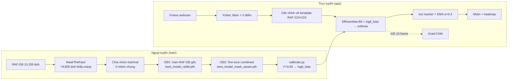
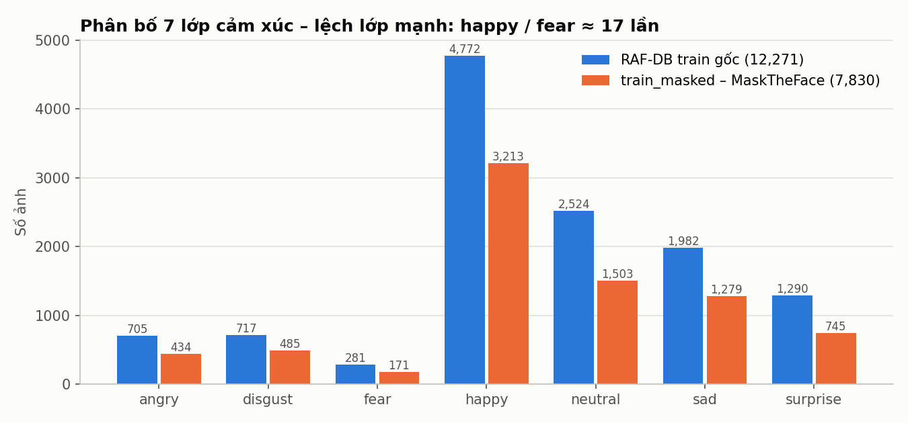
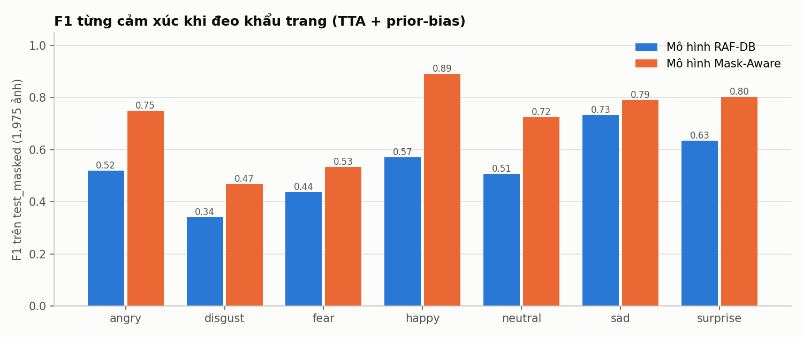
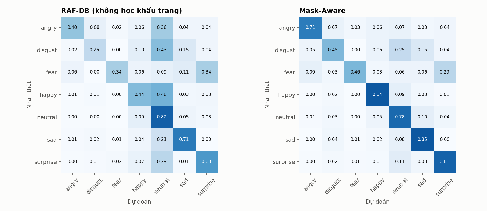
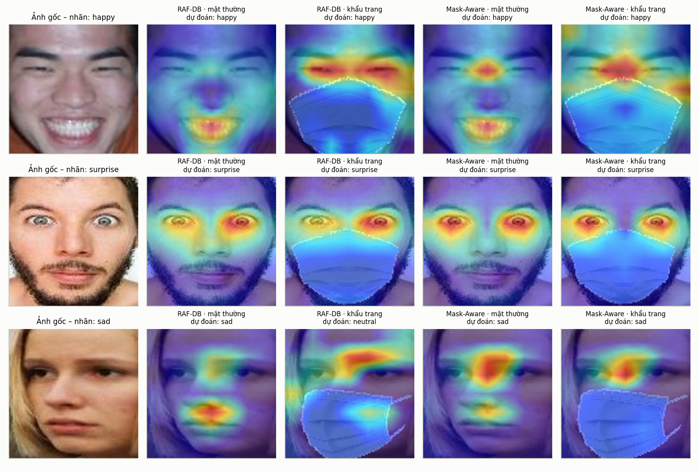
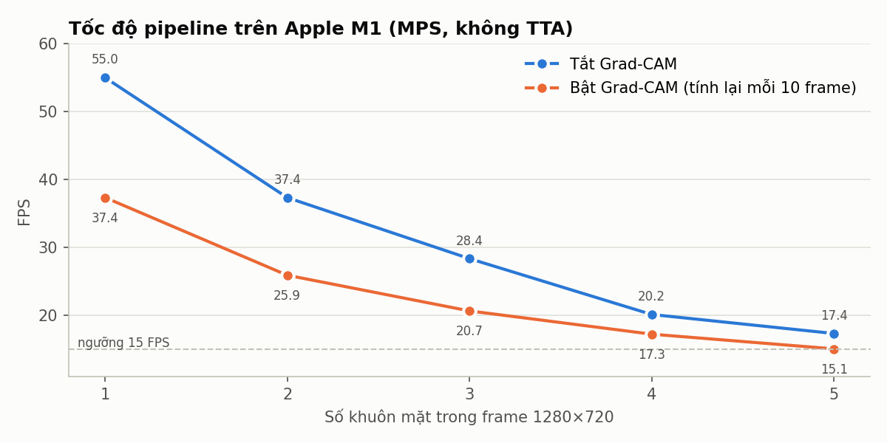

# 🎓 TÀI LIỆU HỌC & ÔN VẤN ĐÁP — XAI-FER Mask-Aware

> **Mục tiêu:** học xong tài liệu này bạn (1) giải thích được *mọi* khối trong hệ thống bằng lời của mình,
> (2) chỉ ra được code nằm ở đâu, (3) trả lời được câu hỏi phản biện của giảng viên **bằng số liệu kiểm chứng được**,
> và (4) biết trước những điểm yếu của đề tài để chủ động trả lời thay vì bị bắt lỗi.
>
> **Nguồn số liệu:** mọi con số trong tài liệu này đều lấy từ file trong repo (`output/*.json`, `output/leakage_report.txt`)
> hoặc được **chạy lại** bằng `scripts/study_analysis.py` (kết quả lưu ở `docs/images/study_metrics.json`).
> Các con số chính thức đã được tái lập khớp 100% (89.15 / 56.61 / 76.40 / 88.43 / 79.29 / 84.85).

---

## MỤC LỤC

0. [Lộ trình học 3 buổi](#0-lộ-trình-học-3-buổi)
1. [Kết quả review `DEEP_TECHNICAL_REPORT.md`](#1-kết-quả-review-deep_technical_reportmd)
2. [Bức tranh tổng thể trong 1 trang](#2-bức-tranh-tổng-thể-trong-1-trang)
3. [Bài toán & nền tảng tâm lý học (FACS)](#3-bài-toán--nền-tảng-tâm-lý-học-facs)
4. [Dữ liệu: RAF-DB, MaskTheFace, mất cân bằng lớp](#4-dữ-liệu-raf-db-masktheface-mất-cân-bằng-lớp)
5. [Rò rỉ dữ liệu & cách chia train/val theo nhóm](#5-rò-rỉ-dữ-liệu--cách-chia-trainval-theo-nhóm)
6. [Phát hiện & căn chỉnh khuôn mặt](#6-phát-hiện--căn-chỉnh-khuôn-mặt)
7. [Mô hình: EfficientNet-B0 / HSEmotion / transfer learning](#7-mô-hình-efficientnet-b0--hsemotion--transfer-learning)
8. [Huấn luyện: 2 giai đoạn, loss, augmentation, EMA](#8-huấn-luyện-2-giai-đoạn-loss-augmentation-ema)
9. [Hiệu chỉnh prior-bias sau huấn luyện](#9-hiệu-chỉnh-prior-bias-sau-huấn-luyện)
10. [Đánh giá: metric, TTA, kết quả, ablation thật](#10-đánh-giá-metric-tta-kết-quả-ablation-thật)
11. [Grad-CAM & hiện tượng dịch chuyển chú ý (đo định lượng)](#11-grad-cam--hiện-tượng-dịch-chuyển-chú-ý-đo-định-lượng)
12. [Hệ thống thời gian thực: tracker, EMA, cache, FPS](#12-hệ-thống-thời-gian-thực-tracker-ema-cache-fps)
13. [Nhánh R: TorchScript, parity test, Shiny](#13-nhánh-r-torchscript-parity-test-shiny)
14. [Ngân hàng câu hỏi phản biện khó (và câu trả lời trung thực)](#14-ngân-hàng-câu-hỏi-phản-biện-khó)
15. [Cheat-sheet số liệu phải thuộc](#15-cheat-sheet-số-liệu-phải-thuộc)
16. [Từ điển thuật ngữ](#16-từ-điển-thuật-ngữ)
17. [Tái lập hình & số liệu](#17-tái-lập-hình--số-liệu)

---

## 0. LỘ TRÌNH HỌC 3 BUỔI

| Buổi | Đọc | Tự kiểm tra (nói to, không nhìn tài liệu) |
|---|---|---|
| 1 (≈2h) | §1, §2, §3, §4, §5 | Vẽ lại sơ đồ pipeline. Giải thích vì sao chia ngẫu nhiên gây rò rỉ và nhóm sửa thế nào. Kể tên 3 AU vùng mắt. |
| 2 (≈2.5h) | §6, §7, §8, §9 | Viết lại công thức logit-adjusted loss. Giải thích vì sao sau khi train bằng LA lại cộng `t·log π` lúc suy luận. Giải thích MBConv + SE. |
| 3 (≈2.5h) | §10 → §15 | Đọc thuộc bảng §15. Tự trả lời 20 câu ở §14 trong 1 phút/câu. Mở `fig05`, `fig07` và tự diễn giải. |

**Quy tắc vàng khi trả lời giảng viên:** *Khẳng định → Bằng chứng (số / file / hình) → Giới hạn.*
Ví dụ: "Mô hình Mask-Aware tăng 22.68 điểm % accuracy trên ảnh đeo khẩu trang (56.61 → 79.29), số trong
`output/best_model_mask_aware_tta_eval.json`; tuy nhiên khẩu trang trong tập test là khẩu trang **tổng hợp** cùng
công cụ với tập train, nên con số trên khẩu trang thật có thể thấp hơn."

---

## 1. KẾT QUẢ REVIEW `DEEP_TECHNICAL_REPORT.md`

**Kết luận:** báo cáo có cấu trúc tốt, các con số *chính* (bảng 10.1, 10.2, leakage, FPS) **đúng và tái lập được**.
Tuy nhiên có **một số khẳng định sai hoặc không có bằng chứng** — đúng loại mà giảng viên hay bắt. Mình đã sửa trực
tiếp trong báo cáo (xem `git diff docs/DEEP_TECHNICAL_REPORT.md`). Bạn cần biết các lỗi này vì các file
`PRESENTATION_GUIDE.md` và `SPEAKER_*.md` **vẫn còn** một số câu tương tự.

| Mức | Chỗ trong báo cáo cũ | Vấn đề | Đã sửa thành |
|---|---|---|---|
| 🔴 Nghiêm trọng | §10.3 Ablation "+2.10% nhờ YuNet Alignment & TTA" | **Không thể đúng:** khi đánh giá trên tập test RAF-DB, ảnh đã được căn chỉnh sẵn, `evaluate.py` **không chạy YuNet**. Chạy lại: TTA còn làm giảm 0.29 điểm (84.22 → 83.93). Toàn bộ mức tăng 84.22 → 89.15 đến từ **prior-bias**. | Bảng ablation thật (§10.4, `fig02`). |
| 🔴 Nghiêm trọng | §8.3 "75% năng lượng ở khóe miệng", "dịch chuyển 100% lên mắt", "miệng bị dập tắt về 0" | Không có phép đo nào. Đo thật trên 1,975 cặp ảnh: phần năng lượng CAM ở nửa trên chỉ tăng 47% → 58% (Mask-Aware), **vẫn còn ~42% nằm trên vùng khẩu trang**. Và mô hình RAF-DB *cũng* dịch chuyển (42% → 55%). | Số đo thật (§11.3, `fig07`). |
| 🟠 Sai sự thật | §5.1 bảng so sánh ResNet-50 / Swin-T kèm FPS | Dự án **không train** ResNet-50 hay Swin-T (code chỉ có ResNet-18). Cột FPS ~48/18/12 không có file đo. MobileNetV3-L có ~5.5M tham số chứ không phải 4.2M. | Ghi rõ "số liệu tham khảo từ paper, không đo trong dự án". |
| 🟠 Sai sự thật | §2.2 MaskTheFace "PnP, lưới 3D, SO(3)" | MaskTheFace dùng 68 landmark dlib, ước lượng góc nghiêng 2D rồi **warp ảnh mẫu khẩu trang 2D** vào các điểm mốc. Không có PnP/mesh 3D. Chỉ dùng 1 kiểu `surgical`. | Mô tả đúng + giải thích vì sao chỉ 63.8% ảnh có bản khẩu trang. |
| 🟠 Sai sự thật | §4.2 "LMeDS = bình phương tối thiểu có trọng số", công thức tổng bình phương | LMedS = **Least Median of Squares**: tối thiểu *trung vị* bình phương sai số → bền với điểm mốc sai (outlier). | Sửa định nghĩa. |
| 🟠 Sai | §6.2 LowerFaceOcclusion "hình chữ nhật từ 0.45H–0.60H, nhiễu Gaussian" | Code: **đa giác 5 đỉnh** mô phỏng dây khẩu trang, mép trên ở 0.50H–0.62H, 75% màu đặc / 25% nhiễu **đều** (uniform). | Sửa theo `src/dataset.py:71`. |
| 🟡 Thiếu | §6 sơ đồ huấn luyện | Thiếu label smoothing 0.1, AdamW (wd 0.05), linear-warmup + cosine, gradient clipping 5.0, mix_prob 0.5; "Epoch 2–25" sai (1 epoch head + 25 epoch full; giai đoạn 2 không freeze). | Bổ sung. |
| 🟡 Thiếu | §1.1 "7 cảm xúc của Ekman" | Ekman đề xuất **6** cảm xúc cơ bản; *neutral* là lớp thêm vào. | Sửa. |
| 🟡 Không kiểm chứng | §3.1 "2,033/2,848 (71.38%) rò rỉ, Val F1 ảo 0.826" và dòng MobileNetV3 ở §10.1 | Không còn file log/JSON của pipeline cũ trong repo (chỉ có `confusion_matrix_mobilenet_v3_large_raf_db.png` ghi 79.04%). MobileNetV3 cũ dùng val **bị rò rỉ** nên so sánh không công bằng. | Gắn chú thích "số liệu pipeline cũ, không còn artefact". |
| 🟡 Không kiểm chứng | §9.3 "backward ~90 ms → 7.7 FPS" | File benchmark chỉ đo chế độ cache 10 frame (8.1 ms/frame trung bình). | Ghi là ước lượng. |
| 🟡 Nhỏ | §2 sơ đồ 10,430 / 1,841 gốc | Thực tế 10,429 / 1,842 (đọc từ code chia nhóm). | Sửa. |
| 🟡 Nhỏ | §11 lệnh benchmark | Thiếu `--cam-every 10 --no-tta --json ...` nên không ra đúng file `fps_benchmark_m1.json`. | Sửa. |
| 🐛 Bug code | `R/face_detector.R` | Hàm `estimate_similarity_transform` tính ma trận xoay **bị chuyển vị** (R = UVᵀ thay vì VUᵀ) → mặt nghiêng 20° bị lệch ~42 px sau căn chỉnh. | **Đã sửa** (công thức Umeyama), kiểm chứng sai số ~1e-14 px. |
| ⚠️ Lưu ý demo | `app.R` | Tab dự đoán trong Shiny đang hiển thị **xác suất giả lập cố định** (happy 75%), chưa gọi mô hình. Đừng demo tab này như kết quả thật. | Ghi chú ở §13. |

**Phát hiện mới khi chạy lại (nên đưa vào slide):**
- Mức tăng từ hiệu chỉnh prior-bias là rất lớn: **+4.9 điểm accuracy, +0.07 macro-F1** trên mặt thường với mô hình RAF-DB.
- *t\** chọn trên val gần như trùng *t* tối ưu "nhìn trộm" trên test (masked: 0.85 vs 1.0, chênh F1 chỉ 0.005) → hiệu chỉnh **tổng quát hoá tốt**, không overfit val.
- Mô hình RAF-DB khi gặp khẩu trang dồn **48% ảnh happy** về *neutral* (`fig05`) — đây là bằng chứng mạnh nhất cho động cơ của đề tài.

---

## 2. BỨC TRANH TỔNG THỂ TRONG 1 TRANG

**Câu chuyện 60 giây (học thuộc):**
> Khẩu trang che nửa dưới khuôn mặt nên mô hình nhận diện cảm xúc thông thường "mù": accuracy rơi từ 89% xuống 57%,
> phần lớn ảnh vui bị đoán thành bình thường. Nhóm dùng EfficientNet-B0 đã tiền huấn luyện trên khuôn mặt (HSEmotion),
> fine-tune 2 giai đoạn: trên RAF-DB gốc rồi trên RAF-DB + ảnh đeo khẩu trang tổng hợp, chia train/val theo nhóm
> để không rò rỉ. Mất cân bằng lớp được xử lý bằng Logit-Adjusted loss và hiệu chỉnh prior-bias trên val. Kết quả: 79.3%
> trên ảnh khẩu trang (+22.7 điểm) mà vẫn giữ 88.4% trên mặt thường. Grad-CAM cho thấy mô hình chuyển chú ý lên vùng mắt.
> Hệ thống chạy thời gian thực đa khuôn mặt ~37 FPS (1 mặt, có Grad-CAM) trên Apple M1.



<!-- Hình khái niệm (tạo bằng Gemini, xem docs/images/GEMINI_PROMPTS.md):

-->

**Bản đồ code** (nhớ để trả lời "phần đó nằm ở đâu?"):

| Khối | File | Hàm / lớp chính |
|---|---|---|
| Dữ liệu, augmentation, chia nhóm | `src/dataset.py` | `source_group`, `get_val_groups`, `LowerFaceOcclusion`, `get_transforms` |
| Kiến trúc | `src/models.py` | `PretrainedFER`, `_load_hsemotion_weights`, `get_last_conv_layer` |
| Huấn luyện | `src/train.py` | `FERLoss`, `mix_batch`, `build_scheduler`, `run_training` |
| Hiệu chỉnh | `src/calibrate.py`, `src/inference.py` | `calibrate_checkpoint`, `calibrate_prior_bias` |
| Đánh giá | `src/evaluate.py` | `evaluate_model`, `plot_cm` |
| Phát hiện/căn chỉnh | `src/face_detector.py` | `MultiFaceDetector`, `align_face`, `RAF_TEMPLATE` |
| XAI | `src/gradcam.py` | `GradCAM.generate_heatmap`, `overlay_heatmap_on_image` |
| Suy luận + tracker | `src/inference.py` | `FERPredictor`, `FaceTracker` |
| Kiểm toán rò rỉ | `scripts/check_leakage.py` | `dhash`, `popcount64`, `nearest` |
| Benchmark FPS | `scripts/benchmark_fps.py` | `run_pipeline` |
| Xuất cho R | `scripts/export_jit.py`, `tests/test_jit_parity.py` | `JITFERWrapper` |
| Ứng dụng | `app.py` (Streamlit), `webcam_app.py` (OpenCV), `app.R` (Shiny) | |

---

## 3. BÀI TOÁN & NỀN TẢNG TÂM LÝ HỌC (FACS)

### 3.1 Bài toán
- **Đầu vào:** ảnh khuôn mặt (có thể đeo khẩu trang). **Đầu ra:** 1 trong 7 lớp
  `angry, disgust, fear, happy, neutral, sad, surprise` + bản đồ giải thích.
- Đây là **phân loại đa lớp, một nhãn** (single-label multi-class), không phải đa nhãn.
- Ekman (1971) đề xuất **6 cảm xúc cơ bản** mang tính phổ quát liên văn hoá (vui, buồn, giận, sợ, ghê tởm, ngạc nhiên);
  RAF-DB thêm **neutral** → 7 lớp. (Một số bộ như AffectNet thêm *contempt* → 8 lớp; HSEmotion gốc có 8 lớp và
  nhóm đã **bỏ hàng contempt** khi khởi tạo head, xem §7.3.)

### 3.2 FACS và Action Units (AU)
FACS (Ekman & Friesen 1978) mô tả mọi biểu cảm bằng các **đơn vị vận động cơ (AU)**. Cần nhớ phân vùng:

| Vùng | AU | Tên | Gắn với |
|---|---|---|---|
| **Trên (còn thấy khi đeo khẩu trang)** | AU1, AU2 | nâng chân mày trong / ngoài | sad, fear, surprise |
| | AU4 | hạ/nhíu chân mày | angry, sad, fear |
| | AU5 | nâng mí trên (mắt mở to) | surprise, fear |
| | AU6 | nâng gò má – nếp chân chim | **happy (Duchenne)** |
| | AU7 | căng mí | angry, fear |
| **Dưới (bị che)** | AU9, AU10 | nhăn mũi, nâng môi trên | **disgust** |
| | AU12 | kéo khoé môi lên | **happy** |
| | AU15 | hạ khoé môi | sad |
| | AU20 | kéo ngang môi | fear |
| | AU25/26 | hé môi / há miệng | surprise, fear |

<!--  -->

**Nụ cười Duchenne:** nụ cười thật = AU12 + **AU6**. Khi khẩu trang che AU12, mô hình vẫn có thể nhận ra *happy* qua AU6
(nếp nhăn đuôi mắt). Đây là giả thuyết lý thuyết giải thích vì sao *happy* vẫn đạt F1 0.89 khi đeo khẩu trang.

**Dự đoán lý thuyết → kiểm chứng bằng số liệu:**
- *Disgust* phụ thuộc AU9/AU10 (đều bị che) → lớp khó nhất khi đeo khẩu trang: **F1 0.467** ✔️
- *Fear* mất AU20, chỉ còn AU1+2+4+5 giống *surprise* → nhầm sang surprise **29%** (`fig05`) ✔️
- *Angry/sad* dựa nhiều vào chân mày (AU4, AU1) → giữ tốt (F1 0.75 / 0.79) ✔️

### ❓ Câu hỏi giảng viên — §3
**Q: Tại sao chọn 7 lớp rời rạc mà không dùng mô hình liên tục valence–arousal?**
A: RAF-DB gán nhãn rời rạc 7 lớp; mô hình valence–arousal cần dữ liệu có nhãn liên tục (AffectNet có, RAF-DB basic thì không).
Rời rạc cũng dễ giải thích cho người dùng. Hạn chế: cảm xúc pha trộn (RAF-DB có tập *compound* 11 lớp nhưng nhóm không dùng).

**Q: AU có được dùng làm đặc trưng đầu vào không?**
A: **Không.** Mô hình học trực tiếp từ pixel (end-to-end). FACS chỉ dùng để **giải thích** kết quả và Grad-CAM. Đừng nói
"mô hình nhận diện AU6" như một sự thật đo được — chính xác là "heatmap tập trung ở vùng đuôi mắt, phù hợp với AU6".

---

## 4. DỮ LIỆU: RAF-DB, MASKTHEFACE, MẤT CÂN BẰNG LỚP

### 4.1 RAF-DB
- 15,339 ảnh *in-the-wild* (từ internet), ~40 người gán nhãn mỗi ảnh. Dùng bản **aligned 100×100** (đã căn chỉnh theo 5 điểm).
- Train chính thức 12,271, test chính thức 3,068.

| Lớp | Train | Test | Train masked | Test masked |
|---|---:|---:|---:|---:|
| angry | 705 | 162 | 434 | 102 |
| disgust | 717 | 160 | 485 | 102 |
| fear | 281 | 74 | 171 | 35 |
| happy | 4,772 | 1,185 | 3,213 | 805 |
| neutral | 2,524 | 680 | 1,503 | 420 |
| sad | 1,982 | 478 | 1,279 | 305 |
| surprise | 1,290 | 329 | 745 | 206 |
| **Tổng** | **12,271** | **3,068** | **7,830** | **1,975** |



- Tỷ lệ mất cân bằng: happy/fear = 4,772/281 ≈ **17 lần** (38.9% vs 2.3%).

### 4.2 MaskTheFace (Anwar & Raychowdhury 2020)
Cách hoạt động thật (thư mục `MaskTheFace/`):
1. Dò khuôn mặt + **68 landmark bằng dlib**.
2. Từ landmark tính các điểm neo (sống mũi, hai bên má, cằm) và **góc nghiêng** của mặt.
3. **Warp ảnh mẫu khẩu trang 2D** (ở đây kiểu `surgical`) khớp vào các điểm neo, rồi dán lên ảnh.
4. Nhãn giữ nguyên: ảnh `raf_train_00012_surgical.jpg` có cùng nhãn với `raf_train_00012.jpg`.

**Vì sao chỉ 7,830/12,271 (63.8%) ảnh train có bản khẩu trang?** Dlib (HOG) không dò được mặt trên ảnh 100×100 nhỏ,
nghiêng nhiều hoặc bị che → MaskTheFace bỏ qua ảnh đó. Hệ quả: tập masked bị **lệch về mặt chính diện, dễ** — một giới hạn
cần nói ra.

### ❓ Câu hỏi giảng viên — §4
**Q: Khẩu trang tổng hợp có đại diện cho khẩu trang thật không?**
A: Không hoàn toàn. Chỉ 1 kiểu (surgical), cùng một thuật toán dán cho cả train và test → mô hình có thể học "dấu vết" của
MaskTheFace. Nhóm giảm rủi ro bằng **LowerFaceOcclusion** (che ngẫu nhiên nhiều màu, nhiều hình dạng lúc train). Nhưng
**chưa có đánh giá định lượng trên khẩu trang thật** (thư mục `data/real_masked_faces/` có 350 ảnh nhưng không có nhãn cảm
xúc). Đây là hướng phát triển.

**Q: Vì sao không dùng FER-2013?**
A: FER-2013 là ảnh xám 48×48, nhãn nhiễu (~65% độ đồng thuận người), chất lượng thấp. RAF-DB ảnh màu, nhãn đáng tin hơn,
là benchmark *in-the-wild* chuẩn. HSEmotion cũng cần ảnh màu 224×224.

**Q: Tập test masked 1,975 ảnh có chứa người trong tập train không?**
A: Không. Kiểm toán dHash: 1,973/1,975 ảnh test_masked khớp đúng ảnh gốc **trong test**, 0 ảnh có nguồn thuộc train.

---

## 5. RÒ RỈ DỮ LIỆU & CÁCH CHIA TRAIN/VAL THEO NHÓM

### 5.1 Vấn đề
Mỗi ảnh gốc có "anh em sinh đôi" đeo khẩu trang (cùng người, cùng ảnh, chỉ khác nửa dưới). Nếu gộp tất cả rồi chia
**ngẫu nhiên** 85/15, một ảnh ở val có xác suất 85% có bản sinh đôi nằm trong train → mô hình "nhớ mặt" thay vì học
biểu cảm → **val F1 cao ảo** → early stopping, chọn checkpoint và hiệu chỉnh `t` đều sai.

<!--  -->

### 5.2 Cách sửa: chia theo nhóm (group split)
```python
# src/dataset.py
_GROUP_RE = re.compile(r"^(raf_(?:train|test)_\d+)")
source_group("raf_train_00012_surgical.jpg")  # -> "raf_train_00012"
```
- Mọi ảnh cùng khoá nhóm (ảnh gốc + bản khẩu trang) **luôn cùng một phía**.
- Chia **phân tầng theo nhãn** (mỗi lớp lấy 15% nhóm vào val, seed 42) → tỷ lệ lớp ở val giống train.
- Danh sách nhóm val lưu cố định ở `data/splits/val_groups_r15_s42.json` và **dùng chung cho cả 2 giai đoạn** → checkpoint
  giai đoạn 1 không bao giờ thấy ảnh val của giai đoạn 2.
- Có `assert` trong code: giao của nhóm train và nhóm val phải rỗng.

Kết quả: combined train 17,099 (10,429 gốc + 6,670 khẩu trang), val 3,002 (1,842 + 1,160), **0 nhóm chung**.

### 5.3 Kiểm toán bằng nội dung ảnh (dHash) — `scripts/check_leakage.py`
Không tin tên file, kiểm tra bằng chính pixel:
1. **dHash 64 bit:** ảnh xám → resize 9×8 → so sánh từng cặp pixel kề nhau theo chiều ngang → 8×8 = 64 bit.
2. **Khoảng cách Hamming** = số bit khác nhau = `popcount(h1 XOR h2)`; ≤ 6 coi là cùng nguồn.
3. So ảnh khẩu trang với ảnh gốc: chỉ băm **42% phía trên** (vùng không bị che).
4. So train–test ảnh gốc: băm toàn ảnh, rồi **xác nhận** bằng tương quan pixel ≥ 0.93 (vì mọi ảnh RAF-DB đều căn theo
   một template nên dHash hay báo nhầm).

Kết quả (`output/leakage_report.txt`, 25,144 ảnh):
- train_masked → khớp ảnh gốc 7,818/7,830, **0** ảnh có nguồn ngoài train.
- test_masked → khớp 1,973/1,975, **0** ảnh có nguồn trong train.
- train vs val: **0 nhóm chung**.
- **49/3,068 ảnh test (1.6%)** gần trùng ảnh train trong *chính split gốc của RAF-DB* (cùng người/cùng buổi chụp; 3 cặp còn
  khác nhãn → nhãn RAF-DB có nhiễu). Không phải lỗi của nhóm; bỏ chúng khỏi test chỉ thay đổi accuracy ~0.1–0.2 điểm.

### ❓ Câu hỏi giảng viên — §5
**Q: Tại sao dHash mà không phải MD5?**
A: MD5 thay đổi hoàn toàn khi chỉ 1 pixel khác; ảnh khẩu trang khác ảnh gốc ở nửa dưới nên MD5 vô dụng. dHash là
*perceptual hash*: ảnh giống nhau về cấu trúc thì hash gần nhau, và chỉ băm nửa trên nên bỏ qua khẩu trang.

**Q: Ngưỡng Hamming 6 lấy ở đâu?**
A: Từ phân bố khoảng cách: 1,580/1,975 ảnh test_masked có d = 0, đuôi phân bố tắt dần ở 6; sau 6 chỉ còn vài ca lẻ (d = 10, 11).
Các ca khớp nhầm được loại bằng bước xác nhận tương quan pixel.

**Q: Group split có làm val khó hơn không? Vậy có công bằng không?**
A: Có, val khó hơn — nhưng **đó mới là con số thật**. Val không rò rỉ mới dùng được cho early stopping và hiệu chỉnh `t`.

**Q: Rò rỉ train/test thì sao — tập test có bị dùng lúc chọn mô hình không?**
A: Không. Checkpoint được chọn theo **val macro-F1**, `t` chọn trên **val**. Tập test chỉ chạy một lần ở cuối (`evaluate.py`).

---

## 6. PHÁT HIỆN & CĂN CHỈNH KHUÔN MẶT

### 6.1 YuNet
- CNN siêu nhẹ của OpenCV (`face_detection_yunet_2023mar.onnx`, ~227 KB), **anchor-free một giai đoạn**.
- Trả về: bbox, điểm tin cậy và **5 landmark** (2 mắt, mũi, 2 khoé miệng). Ngưỡng score 0.7, NMS 0.3, mặt tối thiểu 32 px.
- Frame được **thu nhỏ về rộng 640** để dò nhanh (~5.5 ms), tọa độ nhân ngược lại để cắt trên frame gốc (giữ độ nét).
- Dự phòng: **Haar Cascade** nếu không nạp được YuNet (khi đó không có landmark → crop vuông nới 1.1×).

### 6.2 Vì sao phải căn chỉnh?
Mô hình học trên RAF-DB **aligned** — mắt, mũi, miệng luôn ở cùng vị trí. Nếu lúc chạy app chỉ crop bbox, vị trí bộ phận
khuôn mặt bị lệch → **phân phối train và inference khác nhau** (distribution shift) → dự đoán kém.

### 6.3 Phép biến đổi tương tự (similarity transform)
$$\mathbf{M}=\begin{bmatrix} s\cos\theta & -s\sin\theta & t_x\\ s\sin\theta & s\cos\theta & t_y\end{bmatrix}$$
4 bậc tự do: xoay θ, tỉ lệ đều s, tịnh tiến (tx, ty). **Không** méo/cắt xén (khác affine 6 bậc tự do) → giữ nguyên
hình dạng khuôn mặt.

- Tìm M bằng `cv2.estimateAffinePartial2D(landmarks, RAF_TEMPLATE*224, method=cv2.LMEDS)`.
- **LMedS (Least Median of Squares):** thay vì tối thiểu *tổng* bình phương sai số (dễ bị 1 điểm mốc sai kéo lệch), nó tối
  thiểu *trung vị* bình phương sai số → chịu được tới ~50% điểm sai.
- `RAF_TEMPLATE`: toạ độ trung bình của 5 điểm, đo bằng cách chạy YuNet trên ~1,000 ảnh RAF-DB test (độ lệch chuẩn ~0.03,
  chứng tỏ RAF-DB thật sự được căn theo template cố định):

| Điểm | x | y |
|---|---|---|
| mắt trái ảnh | 0.2696 | 0.3213 |
| mắt phải ảnh | 0.7026 | 0.3157 |
| mũi | 0.4809 | 0.5654 |
| khoé miệng trái | 0.2996 | 0.7345 |
| khoé miệng phải | 0.6892 | 0.7288 |

<!--  -->

### ❓ Câu hỏi giảng viên — §6
**Q: Căn chỉnh giúp tăng bao nhiêu accuracy?**
A: **Trả lời trung thực:** không đo được trên tập test, vì ảnh test RAF-DB đã được căn sẵn. Căn chỉnh chỉ có tác dụng trong
**ứng dụng thực tế** (webcam). Báo cáo cũ ghi "+2.10% nhờ YuNet" là sai và đã được bỏ. Muốn có số, cần một tập ảnh thô
chưa căn chỉnh có nhãn (hướng phát triển).

**Q: Vì sao YuNet mà không MediaPipe Face Mesh (468 điểm)?**
A: Chỉ cần 5 điểm để khớp template RAF-DB (vốn được tạo từ 5 điểm). YuNet nhẹ (~227 KB), có sẵn trong OpenCV, dò nhiều mặt
cùng lúc và vẫn dò được mặt đeo khẩu trang. Face Mesh nặng hơn và thừa điểm.

**Q: Khi đeo khẩu trang YuNet có dò được khoé miệng không?**
A: YuNet vẫn *ước lượng* vị trí khoé miệng (dựa vào hình dạng mặt), sai số lớn hơn. LMedS giúp giảm ảnh hưởng của các
điểm sai đó.

---

## 7. MÔ HÌNH: EFFICIENTNET-B0 / HSEMOTION / TRANSFER LEARNING

### 7.1 Vì sao EfficientNet-B0 (bản HSEmotion)?
| | MobileNetV3-L | ResNet-18 | **HSEmotion EfficientNet-B0** |
|---|---|---|---|
| Tham số (backbone) | ~3.0M (5.5M cả head ImageNet) | ~11.2M | **~4.0M** |
| FLOPs @224 | ~0.22 G | ~1.8 G | **~0.39 G** |
| Tiền huấn luyện | ImageNet | ImageNet | **ImageNet → VGGFace2 → AffectNet (khuôn mặt + cảm xúc)** |
| Có trong code | ✔️ | ✔️ | ✔️ (mặc định) |

> Số tham số/FLOPs là số chuẩn của kiến trúc (paper/timm). FPS chỉ đo cho B0 (§12). Dự án **không** thử ResNet-50 hay Swin-T.

Lý do chính là **miền tiền huấn luyện**: backbone đã học đặc trưng khuôn mặt và cảm xúc nên chỉ cần fine-tune ít.

### 7.2 Khối MBConv + Squeeze-and-Excitation
1. **Conv 1×1 mở rộng** kênh (×6, trừ khối đầu ×1) → BN → SiLU (Swish).
2. **Depthwise conv 3×3 hoặc 5×5**: mỗi kênh một bộ lọc riêng → rẻ. Tỉ lệ chi phí so với conv thường ≈ $\frac{1}{C_{out}}+\frac{1}{K^2}$.
3. **SE block:** Global Average Pooling → FC giảm kênh → SiLU → FC → sigmoid → nhân lại vào từng kênh = "chú ý theo kênh".
4. **Conv 1×1 chiếu** về số kênh nhỏ (không activation — *linear bottleneck*) + **skip connection** nếu cùng kích thước.

Gọi là *inverted* bottleneck vì hẹp → rộng → hẹp (ngược ResNet: rộng → hẹp → rộng).
Cuối mạng: `conv_head` 1×1 (320 → 1280 kênh) → `bn2` (BN + SiLU) → feature map **1280 × 7 × 7** → GAP → head.

<!--  -->

### 7.3 HSEmotion và cách khởi tạo head (`src/models.py`)
- Trọng số `enet_b0_8_best_afew` (Savchenko 2021): EfficientNet-B0 train nhận dạng danh tính trên **VGGFace2**, rồi fine-tune
  cảm xúc 8 lớp trên **AffectNet**.
- Nhóm nạp backbone, **giữ cả classifier AffectNet** nhưng bỏ hàng *contempt* (`HSE_TO_PROJECT_ROWS = {8: [0,2,3,4,5,6,7]}`)
  → mô hình **đã dự đoán được cảm xúc ngay từ epoch 0**, fine-tune hội tụ nhanh.
- Head = `Dropout(0.3) → Linear(1280, 7)`; drop-path 0.1 trong backbone.

### ❓ Câu hỏi giảng viên — §7
**Q: Tại sao không dùng Vision Transformer?**
A: (1) Yêu cầu real-time trên laptop: ViT/Swin nặng hơn ~10 lần FLOPs. (2) RAF-DB nhỏ (12K ảnh) — ViT cần nhiều dữ liệu hoặc
tiền huấn luyện mạnh. (3) Có sẵn trọng số **khuôn mặt + cảm xúc** cho EfficientNet (HSEmotion). Nói rõ: nhóm **không** chạy thực nghiệm ViT.

**Q: Transfer learning ở đây là loại nào?**
A: Fine-tuning toàn mạng với learning rate phân biệt (backbone 1e-4, head 1e-3), sau 1 epoch chỉ train head (backbone đóng băng)
để head không phá hỏng đặc trưng tiền huấn luyện bằng gradient lớn lúc đầu.

**Q: Vì sao ảnh đầu vào chuẩn hoá mean/std ImageNet?**
A: HSEmotion được huấn luyện với chuẩn hoá đó; dùng khác sẽ lệch phân phối đầu vào.

---

## 8. HUẤN LUYỆN: 2 GIAI ĐOẠN, LOSS, AUGMENTATION, EMA

### 8.1 Công thức huấn luyện (đọc từ `output/*_metrics.json`)
| Tham số | Giai đoạn 1 (RAF-DB gốc) | Giai đoạn 2 (Mask-Aware) |
|---|---|---|
| Khởi tạo | HSEmotion | `best_model_rafdb.pth` |
| Dữ liệu | 10,429 ảnh gốc | 17,099 ảnh (gốc + khẩu trang) |
| Head warmup (đóng băng backbone) | 1 epoch, LR 1e-3 | **không** (đã có init) |
| Fine-tune toàn mạng | 25 epoch (tốt nhất: epoch 24) | 20 epoch (tốt nhất: epoch 19) |
| Optimizer | AdamW, LR backbone 1e-4 / head 1e-3, weight decay 0.05 | như GĐ1 |
| Lịch LR | warmup tuyến tính 1 epoch → cosine (về 1% LR) theo từng bước | như GĐ1 |
| Loss | Logit-Adjusted CE, τ = 1.0, label smoothing 0.1 | như GĐ1 |
| Mixup / CutMix | α = 0.2 / 1.0, áp dụng cho 50% batch | như GĐ1 |
| LowerFaceOcclusion | p = 0 | **p = 0.3** |
| RandomErasing | p = 0.25 | p = 0.25 |
| EMA trọng số | 0.998 | 0.998 |
| Khác | batch 64, grad clip 5.0, AMP (GPU), early stopping patience 8 | như GĐ1 |
| Thời gian | 108 phút | 97 phút |

### 8.2 Logit-Adjusted Cross-Entropy (Menon et al., ICLR 2021)
Lúc train cộng vào logits một lượng theo tần suất lớp π:
$$\mathcal{L}_{LA}(x,y)=-\log\frac{e^{f_y(x)+\tau\log\pi_y}}{\sum_c e^{f_c(x)+\tau\log\pi_c}}$$
```python
# src/train.py — FERLoss
adj = tau * torch.log(class_prior)
log_p = F.log_softmax(logits.float() + self.adjust, dim=1)
```
**Trực giác:** lớp hiếm (fear, log π rất âm) bị "trừ điểm" khi tính loss → mô hình phải đẩy logit của fear **cao hơn hẳn** mới
thắng được → học biên phân tách rộng hơn cho lớp hiếm (margin ≈ τ·log(π_c/π_y)). Lúc suy luận dùng logits **chưa cộng** →
mô hình dự đoán như thể các lớp cân bằng (tối ưu *balanced error*).

**So với Weighted CE:** Weighted CE nhân trọng số vào loss → thay đổi độ lớn gradient, dễ làm xác suất méo và train không ổn định.
LA chỉ dịch logits — là **dạng nhất quán Fisher** với balanced error (có cơ sở lý thuyết), không đổi tỉ lệ gradient.

<!--  -->

### 8.3 Augmentation
- **Hình học/màu:** RandomResizedCrop (scale 0.8–1.0), lật ngang, xoay ±10°, dịch ±4%, ColorJitter, grayscale 10%.
- **LowerFaceOcclusion** (`src/dataset.py:71`): với p = 0.3, phủ một **đa giác 5 đỉnh** từ ~0.50–0.62 chiều cao xuống cằm
  (mép trên hơi võng như dây khẩu trang, lề hai bên ngẫu nhiên). 75% tô màu đặc (trắng, xanh y tế, đen…), 25% nhiễu ngẫu nhiên.
  Mục đích: đa dạng hoá "khẩu trang", tránh mô hình chỉ học đúng kiểu khẩu trang MaskTheFace.
- **Mixup:** $\tilde x=\lambda x_i+(1-\lambda)x_j$, $\lambda\sim\text{Beta}(0.2,0.2)$; **CutMix:** dán một hình chữ nhật của ảnh j vào
  ảnh i, $\lambda\sim\text{Beta}(1,1)$, nhãn trộn theo diện tích. Hai kỹ thuật được chọn 50/50 khi batch được trộn.
- **RandomErasing** p = 0.25 (xoá ngẫu nhiên 2–20% diện tích).
- **Label smoothing 0.1:** nhãn đúng 0.9 + 0.1/7 phân đều → chống quá tự tin, hợp với nhãn RAF-DB vốn có nhiễu.

### 8.4 EMA trọng số
$$\theta_{EMA}\leftarrow 0.998\,\theta_{EMA}+0.002\,\theta$$
Cập nhật **sau mỗi bước**; mô hình được **đánh giá và lưu là bản EMA** (`eval_model = ema.module`). EMA = trung bình động của
quỹ đạo trọng số → mượt hơn, thường tổng quát tốt hơn. Với 0.998, "bộ nhớ hiệu dụng" ≈ 1/(1−0.998) = 500 bước ≈ 2 epoch.
`use_buffers=True` → thống kê BatchNorm cũng được lấy trung bình.

### 8.5 AMP (mixed precision)
Train fp16/bf16 trên GPU cho nhanh; **đánh giá luôn fp32** — thực nghiệm của nhóm: đánh giá dưới fp16 làm EfficientNet tụt ~2 điểm.

### ❓ Câu hỏi giảng viên — §8
**Q: Tại sao train 2 giai đoạn mà không train combined ngay?**
A: Giai đoạn 1 học biểu cảm "sạch" trên mặt đầy đủ; giai đoạn 2 thích nghi với che khuất mà không quên (vẫn trộn ảnh gốc
trong combined). Kết quả: mặt thường chỉ giảm 0.72 điểm (89.15 → 88.43) trong khi khẩu trang tăng 22.68 điểm.
*Lưu ý:* nhóm chưa có thực nghiệm train combined từ đầu để so sánh trực tiếp.

**Q: Vì sao chọn checkpoint theo macro-F1 mà không theo accuracy?**
A: Dữ liệu lệch lớp: một mô hình đoán toàn "happy" đã đạt ~39% accuracy. Macro-F1 lấy trung bình đều 7 lớp nên phạt nặng
việc bỏ rơi fear/disgust.

**Q: Mixup có mâu thuẫn với LowerFaceOcclusion không?**
A: Không — áp dụng ở hai tầng khác nhau: occlusion trên từng ảnh (PIL), Mixup/CutMix trên cả batch (tensor) sau đó.

**Q: Vì sao lại có cả label smoothing và Mixup?**
A: Cả hai đều làm mềm nhãn; Mixup trộn giữa các lớp theo dữ liệu, smoothing trộn đều. Nhóm dùng giá trị nhỏ (0.1) để giảm quá tự tin.
Chưa có ablation tách riêng hai thứ này.

---

## 9. HIỆU CHỈNH PRIOR-BIAS SAU HUẤN LUYỆN

### 9.1 Vì sao cần?
Mô hình LA dự đoán **như thể 7 lớp bằng nhau**, nhưng test (và đời thực) lệch mạnh về happy/neutral. Với logits thô
(mô hình RAF-DB, mặt thường): fear có **recall 0.78 nhưng precision chỉ 0.32**, disgust recall 0.81 / precision 0.51 (đoán thừa lớp hiếm).

### 9.2 Công thức
$$\hat y=\arg\max_c\big(f_c(x)+t\cdot\log\pi_c\big)$$
- t = 0: logits thô (cân bằng). t = 1: hoàn toàn quay về phân phối tần suất train.
- **Chọn t\* trên VAL** (lưới −0.5 → 1.5, bước 0.05, có TTA), tối đa macro-F1 (hoà → accuracy cao hơn → |t| nhỏ hơn).
- Lưu `logit_bias = t*·log π` vào checkpoint; `evaluate.py`, `app.py`, `webcam_app.py` và bản TorchScript đều tự cộng.

| Mô hình | t* | Val F1 t=0 → t* | Val Acc t=0 → t* |
|---|---|---|---|
| RAF-DB | 0.70 | 0.752 → **0.819** | 83.6% → **88.7%** |
| Mask-Aware | 0.85 | 0.711 → **0.772** | 79.5% → **84.6%** |


Sau hiệu chỉnh (mặt thường, Mask-Aware): precision fear 0.32 → **0.74**, recall 0.74 → 0.61 — đổi một ít recall lấy rất nhiều precision.

### ❓ Câu hỏi giảng viên — §9
**Q: Cộng lại 0.85·log π gần như huỷ Logit Adjustment. Vậy train LA làm gì, sao không train CE thường?**
A: (Câu hỏi hay nhất về đề tài — học kỹ.) LA tác động lên **quá trình học biểu diễn**: lớp hiếm nhận gradient mạnh hơn nên
đặc trưng của fear/disgust được học tốt hơn. Prior-bias chỉ **dời ngưỡng quyết định** lúc suy luận, không thay đổi đặc trưng.
Hai thứ bổ sung nhau: LA → đặc trưng cân bằng; bias → ngưỡng khớp phân phối thực tế. Nói trung thực: nhóm **chưa có thực nghiệm
train CE thường + cùng bước hiệu chỉnh** để chứng minh định lượng phần đóng góp của LA — nên nêu là hướng ablation tiếp theo.

**Q: Chọn t trên test có phải gian lận không? Nhóm có làm vậy không?**
A: Chọn trên test là rò rỉ thông tin test. Nhóm chọn trên **val**. Kiểm tra thêm: t tối ưu nếu "nhìn trộm" test masked là 1.0,
F1 0.713, so với t* = 0.85 cho F1 0.708 → chênh 0.005 → **hiệu chỉnh tổng quát tốt, không phụ thuộc vào việc nhìn test**.

**Q: Đây có phải "calibration" theo nghĩa xác suất (ECE, temperature scaling) không?**
A: Không hẳn. Đây là **điều chỉnh prior / ngưỡng quyết định** để tối ưu macro-F1, không nhằm làm xác suất đúng với tần suất.
Temperature scaling chia logits cho T — không đổi argmax nên không đổi accuracy. Nhóm chưa đo ECE.

**Q: Trong đời thực tỉ lệ cảm xúc khác RAF-DB thì sao?**
A: t chỉ là 1 số, có thể chỉnh lại trên dữ liệu đích mà **không cần train lại**. Đó là ưu điểm của cách làm này.

---

## 10. ĐÁNH GIÁ: METRIC, TTA, KẾT QUẢ, ABLATION THẬT

### 10.1 Metric
- **Accuracy** = đúng / tổng. Bị lớp lớn chi phối.
- **Precision_c** = trong các ảnh đoán là c, bao nhiêu đúng. **Recall_c** = trong các ảnh thật là c, bắt được bao nhiêu.
- **F1_c** = trung bình điều hoà P và R. **Macro-F1** = trung bình đều F1 của 7 lớp → mỗi lớp quan trọng như nhau.
- **Confusion matrix chuẩn hoá theo hàng**: hàng = nhãn thật, mỗi hàng cộng = 1, đường chéo = recall.

### 10.2 TTA (Test-Time Augmentation)
Trung bình logits của ảnh và ảnh lật ngang: `0.5 * (f(x) + f(flip(x)))`. Tốn gấp đôi thời gian. Hiệu quả thực tế **rất nhỏ**
(−0.3 đến +0.6 điểm), xem §10.4. Ứng dụng real-time tắt TTA khi đo FPS.

### 10.3 Kết quả chính (TTA + prior-bias, fp32, `output/*_tta_eval.json`)
| Mô hình | Mặt thường (3,068) | Khẩu trang (1,975) | Tổng hợp (5,043) |
|---|---|---|---|
| HSEmotion-B0 chỉ RAF-DB | **89.15%** / F1 0.833 | 56.61% / F1 0.534 | 76.40% / F1 0.725 |
| HSEmotion-B0 **Mask-Aware** | 88.43% / F1 0.822 | **79.29%** / F1 0.708 | **84.85%** / F1 0.779 |
| Chênh lệch | −0.72 điểm | **+22.68 điểm / +0.174 F1** | **+8.45 điểm / +0.054 F1** |

> Nói "**điểm phần trăm**" (percentage points) chứ không nói "tăng 22.68%" — 56.61 → 79.29 là tăng tương đối 40%.

*(Dòng MobileNetV3 cũ: 79.86% / 73.27% — số từ pipeline cũ có **val bị rò rỉ**, không còn file kết quả; nếu bị hỏi, nói rõ điều này.)*

Từng lớp trên ảnh khẩu trang (Mask-Aware):

| Lớp | Precision | Recall | F1 | Support |
|---|---|---|---|---|
| happy | 0.941 | 0.845 | **0.890** | 805 |
| surprise | 0.798 | 0.806 | 0.802 | 206 |
| sad | 0.738 | 0.849 | 0.790 | 305 |
| angry | 0.800 | 0.706 | 0.750 | 102 |
| neutral | 0.677 | 0.779 | 0.724 | 420 |
| fear | 0.640 | 0.457 | 0.533 | 35 |
| disgust | 0.484 | 0.451 | **0.467** | 102 |





**Cách đọc `fig05` (giảng viên rất hay hỏi):**
- Mô hình RAF-DB trên ảnh khẩu trang: **48% ảnh happy bị đoán là neutral**, 43% disgust → neutral, 36% angry → neutral.
  Khi mất miệng, mô hình chưa học che khuất "lùi về" neutral.
- Mô hình Mask-Aware: happy → neutral còn 9%; cột neutral nhạt hẳn.
- Lỗi còn lại có ý nghĩa giải phẫu: **fear → surprise 29%** (cùng mắt mở to AU5, chân mày nâng AU1+2), **disgust → neutral 25% / sad 15%**.

### 10.4 Ablation thật (chạy lại, accuracy %)
| Mô hình / tập | Logits thô | + TTA | + prior-bias | + TTA + prior-bias |
|---|---|---|---|---|
| RAF-DB / mặt thường | 84.22 | 83.93 | 89.05 | **89.15** |
| RAF-DB / khẩu trang | 49.37 | 49.97 | 56.20 | 56.61 |
| Mask-Aware / mặt thường | 83.70 | 84.06 | 88.43 | 88.43 |
| Mask-Aware / khẩu trang | 73.27 | 73.22 | **79.75** | 79.29 |
| Mask-Aware / tổng hợp | 79.62 | 79.81 | 85.03 | 84.85 |


**Kết luận đúng:** (1) Đóng góp lớn nhất của bước hậu xử lý là **prior-bias** (+4.4 đến +6.8 điểm). (2) TTA gần như không
đóng góp. (3) Đóng góp của **dữ liệu khẩu trang + occlusion** (so 2 mô hình, cùng hậu xử lý) là **+22.68 điểm** trên ảnh khẩu trang.
(4) Căn chỉnh YuNet **không** xuất hiện trong ablation vì không tham gia đánh giá test.

### ❓ Câu hỏi giảng viên — §10
**Q: Kết quả RAF-DB 89.15% so với state-of-the-art thế nào?**
A: SOTA trên RAF-DB 7 lớp khoảng 90–92% (các mô hình lớn/transformer). 89% với mô hình 4M tham số chạy real-time là cạnh
tranh. Lưu ý: con số của nhóm có dùng prior-bias chọn trên val — cách báo cáo nên nêu rõ.

**Q: Fear chỉ 35 ảnh test masked — F1 có tin được không?**
A: Không chắc chắn lắm: đúng/sai 1 ảnh làm recall thay đổi ~2.9 điểm. Nên báo cáo kèm khoảng tin cậy (ví dụ Wilson) hoặc
gộp nhận xét. Đây là giới hạn của dữ liệu.

**Q: Vì sao mặt thường của Mask-Aware lại thấp hơn RAF-DB một chút?**
A: Dung lượng mô hình chia sẻ cho cả hai miền; một phần chú ý chuyển lên vùng mắt nên mất một ít thông tin miệng trên mặt thường
(nhất là disgust/fear). Đánh đổi −0.72 điểm lấy +22.68 điểm là chấp nhận được.

---

## 11. GRAD-CAM & HIỆN TƯỢNG DỊCH CHUYỂN CHÚ Ý (ĐO ĐỊNH LƯỢNG)

### 11.1 Công thức (Selvaraju et al., 2017)
1. Lấy feature map cuối $A^k$ (1280 × 7 × 7) và điểm của lớp c **trước softmax** $y^c$.
2. Trọng số kênh = trung bình gradient: $\alpha_k^c=\frac{1}{49}\sum_{i,j}\frac{\partial y^c}{\partial A^k_{ij}}$.
3. $L^c=\text{ReLU}\big(\sum_k\alpha_k^c A^k\big)$ — ReLU giữ vùng **làm tăng** điểm lớp c.
4. Min-max về [0,1], nội suy song tuyến lên 224×224, tô màu JET, trộn với ảnh.

### 11.2 Chi tiết cài đặt (`src/gradcam.py`)
- Hook vào `model.backbone.bn2` (BN + SiLU sau `conv_head`) → feature map **sau activation**, 1280 kênh, 7×7 — tầng có ngữ nghĩa cao nhất còn giữ không gian.
- Gradient bắt bằng **tensor hook** (`output.register_hook`) thay vì `register_full_backward_hook` — tránh lỗi với activation in-place của timm.
- Trong app, lớp được giải thích = lớp dự đoán cuối cùng (đã cộng bias).

<!--  -->

### 11.3 Đo "attention shift" (mới chạy lại)
Phép đo: với **1,975 cặp** (ảnh test gốc ↔ chính ảnh đó đeo khẩu trang), tính Grad-CAM cho **nhãn thật**, đo tỉ lệ năng lượng heatmap
nằm ở **nửa trên** ảnh (y < 0.5H, phía trên đường khẩu trang).

| Mô hình | Mặt thường | Đeo khẩu trang |
|---|---|---|
| RAF-DB | 41.6% | 54.5% |
| Mask-Aware | 47.1% | **57.7%** |

Riêng lớp happy: RAF-DB 35% → 50%, Mask-Aware **42% → 58%**.




**Diễn giải đúng (đừng nói quá):**
- Có dịch chuyển chú ý lên vùng mắt khi đeo khẩu trang — **ở cả hai mô hình**. Khác biệt của Mask-Aware: heatmap trung bình có
  **một đỉnh tập trung giữa hai mắt/sống mũi** thay vì phân tán, và ngay cả trên mặt thường đã nhìn vùng trên nhiều hơn (47% vs 42%).
- Vẫn còn ~42% năng lượng nằm trên vùng khẩu trang (Grad-CAM 7×7 rất thô, khi nội suy lên 224 thì tràn ra; mô hình cũng có
  thể dùng *hình dạng* khẩu trang/đường viền mặt). **Không** nói "dịch chuyển 100%" hay "miệng về 0".
- Grad-CAM là **giải thích hậu nghiệm, xấp xỉ** — cho biết vùng ảnh hưởng đến điểm lớp, không chứng minh mô hình "hiểu AU6".

### ❓ Câu hỏi giảng viên — §11
**Q: Vì sao Grad-CAM mà không SHAP/LIME?**
A: Grad-CAM chỉ cần 1 forward + 1 backward (~vài chục ms) → dùng được real-time. LIME/SHAP cần hàng trăm lượt chạy mô hình trên
ảnh bị nhiễu → chậm vài giây/ảnh.

**Q: Grad-CAM có hạn chế gì?**
A: Độ phân giải thấp (7×7); phụ thuộc tầng chọn; có thể không "trung thành" với mô hình (sanity checks của Adebayo 2018);
ReLU bỏ mất bằng chứng âm. Có thể bổ sung Grad-CAM++ hoặc Score-CAM.

**Q: Vì sao heatmap ở hình 1 (happy, mặt thường) lại nằm ở miệng và cằm?**
A: Đúng với lý thuyết: AU12 (khoé môi) và AU25/26 (há miệng, lộ răng) là tín hiệu mạnh nhất của happy khi không bị che.

**Q: Làm sao biết attention shift không phải ngẫu nhiên?**
A: Đo trên 1,975 cặp ảnh chứ không phải vài ảnh chọn lọc; tỉ lệ nửa trên tăng nhất quán ở **tất cả 7 lớp** (ví dụ angry 58% → 78%,
fear 56% → 73% với Mask-Aware). Nhưng cũng nói rõ đây là chỉ số thô (chia đôi ảnh).

---

## 12. HỆ THỐNG THỜI GIAN THỰC: TRACKER, EMA, CACHE, FPS

### 12.1 FaceTracker (`src/inference.py`)
1. Tính IoU giữa mọi bbox mới và mọi track cũ.
2. **Ghép tham lam**: sắp IoU giảm dần, ghép nếu IoU ≥ 0.3 và cả hai chưa được dùng.
3. Bbox không ghép được → track mới (ID mới). Track không được cập nhật → `missed += 1`; quá 10 frame (~0.33 s ở 30 FPS) thì xoá.

**Vì sao không dùng Hungarian / SORT / DeepSORT?** Số mặt nhỏ (≤ 5), mặt di chuyển ít giữa 2 frame → greedy IoU đủ tốt, O(MN),
không cần Kalman filter hay đặc trưng ngoại hình. Hạn chế: hai người đi chéo nhau có thể đổi ID.

### 12.2 Làm mượt xác suất (EMA)
$$p^{(t)}_{smooth}=0.6\,p^{(t-1)}_{smooth}+0.4\,p^{(t)}$$
Chống nhãn nhảy liên tục giữa các frame (flicker). α = 0.4 ≈ trung bình 2–3 frame gần nhất → trễ phản hồi ~0.1 s.

### 12.3 Cache Grad-CAM
Backward pass đắt hơn forward nhiều. `webcam_app.py` chỉ tính Grad-CAM cho **mặt lớn nhất**, **mỗi 10 frame** (`GRADCAM_EVERY = 10`),
các frame khác hiển thị lại heatmap cũ. Lý do hợp lý: biểu cảm không đổi đáng kể trong 0.33 s.
Đo được: chi phí Grad-CAM trung bình **8.1 ms/frame** (tức ~80 ms cho mỗi lần tính thật, chia cho 10 frame).

<!--  -->

### 12.4 Benchmark FPS (`output/fps_benchmark_m1.json`)
Apple M1 (GPU MPS), frame 1280×720, **ảnh mặt RAF-DB dán lên nền xám** (chế độ synthetic), không TTA, 60 frame đo sau 10 frame khởi động.

| Số mặt | FPS tắt CAM | FPS bật CAM (mỗi 10 frame) | Detect | Predict | CAM (TB) |
|---|---|---|---|---|---|
| 1 | **55.0** | **37.4** | 5.5 ms | 12.7 ms | 8.1 ms |
| 2 | 37.4 | 25.9 | 5.6 ms | 21.1 ms | 9.1 ms |
| 3 | 28.4 | 20.7 | 5.5 ms | 29.7 ms | 9.1 ms |
| 4 | 20.2 | 17.3 | 6.4 ms | 43.2 ms | 9.1 ms |
| 5 | 17.4 | 15.1 | 6.7 ms | 50.8 ms | 9.2 ms |



Nhận xét: detect gần như hằng số (một lần cho cả frame); **predict tăng tuyến tính theo số mặt** → nút thắt khi đông người.

### ❓ Câu hỏi giảng viên — §12
**Q: Benchmark có phản ánh webcam thật không?**
A: Chưa hoàn toàn: frame tổng hợp, không tính thời gian đọc camera và vẽ giao diện. Script có chế độ `--camera 0` để đo thật;
số FPS thật sẽ thấp hơn. Máy đo là Apple M1; trên CPU thuần sẽ chậm hơn nhiều.

**Q: Vì sao predict 5 mặt (50.8 ms) không rẻ hơn hẳn 5×1 mặt nếu đã batch?**
A: Với MPS và batch nhỏ, chi phí không giảm tuyến tính; tiền xử lý (resize, chuẩn hoá) làm trên CPU từng ảnh. Có thể tối ưu bằng
FP16 trên GPU, ONNX Runtime/TensorRT, hoặc giảm tần suất dự đoán cho mặt đứng yên.

**Q: 15 FPS với 5 mặt có gọi là real-time không?**
A: Thường lấy ≥ 15 FPS là ngưỡng tương tác chấp nhận được; 25–30 FPS là mượt. 1–3 mặt đạt ≥ 20 FPS kể cả bật Grad-CAM.

---

## 13. NHÁNH R: TORCHSCRIPT, PARITY TEST, SHINY

### 13.1 Kiến trúc
- **Train vẫn bằng Python.** `scripts/export_jit.py` bọc mô hình trong `JITFERWrapper` (cộng sẵn `logit_bias` dưới dạng buffer), trace ra
  `output/*_jit.pt` + `*_jit_meta.json` (classes, mean/std, logit_bias).
- **R** dùng gói `torch` (chạy trên LibTorch C++, không cần Python) → `torch::jit_load()` nạp file `.pt`.
- `R/dataset.R` (chia nhóm, tiền xử lý), `R/face_detector.R` (căn chỉnh 5 điểm), `R/gradcam.R` (công thức Grad-CAM + bảng màu JET),
  `R/inference.R` (IoU tracker + EMA), `app.R` (giao diện Shiny + bslib).
- `tests/test_jit_parity.py`: so xác suất PyTorch vs TorchScript trên 10 ảnh/mô hình → sai số tối đa < 1e-4, argmax trùng 100%.

<!--  -->

### 13.2 Những điều phải biết (trung thực)
- **Đã sửa bug** trong `R/face_detector.R`: ma trận xoay bị chuyển vị. Công thức đúng (Umeyama): $H=X_{src}^\top X_{dst}=U\Sigma V^\top$,
  $R=V\,\text{diag}(1,\det(VU^\top))\,U^\top$, $s=\text{tr}(\Sigma D)/\|X_{src}\|^2$. Bản R dùng **bình phương tối thiểu** (không LMedS như OpenCV)
  nên kém bền với landmark sai.
- **Grad-CAM trong R chưa chạy end-to-end với mô hình JIT**: wrapper chỉ trả về logits, không xuất feature map của `bn2`, nên R không lấy
  được $A^k$ và gradient. `R/gradcam.R` mới là phần công thức.
- **Tab dự đoán trong `app.R` đang hiển thị dữ liệu giả lập** (happy 75% cố định). Bảng benchmark trong app là số copy từ Python.
- R chưa có detector YuNet (cần gói `opencv` R hoặc Rcpp).

### ❓ Câu hỏi giảng viên — §13
**Q: Vì sao không train lại trong R?**
A: Có thể (R `torch` có autograd, `optim_adamw`), nhưng timm/HSEmotion chỉ có trên Python. TorchScript giữ **đúng 100% trọng số và
phép tính**, đã kiểm chứng bằng parity test → không cần train lại.

**Q: TorchScript trace khác script thế nào?**
A: *Trace* ghi lại các phép toán khi chạy với một input mẫu → không giữ được rẽ nhánh phụ thuộc dữ liệu. EfficientNet không có rẽ nhánh
động nên trace là đủ. *Script* biên dịch cả luồng điều khiển Python.

**Q: R có lợi ích gì so với Python ở đề tài này?**
A: Phân tích thống kê kết quả (khoảng tin cậy, kiểm định McNemar giữa 2 mô hình), báo cáo tái lập bằng Quarto, đồ thị ggplot2, Shiny
reactive. Phần suy luận deep learning thì Python vẫn nhanh và đầy đủ hệ sinh thái hơn.

---

## 14. NGÂN HÀNG CÂU HỎI PHẢN BIỆN KHÓ

> Mỗi câu: trả lời ≤ 1 phút, theo khung *Khẳng định → Bằng chứng → Giới hạn*.

1. **"Đóng góp mới của nhóm là gì? Toàn dùng thứ có sẵn."**
   → Đóng góp nằm ở **kỹ thuật hệ thống và quy trình đánh giá đúng**: (a) phát hiện và loại bỏ rò rỉ giữa ảnh gốc–ảnh khẩu trang
   (chia nhóm + kiểm toán dHash); (b) công thức train 2 giai đoạn + occlusion giúp +22.68 điểm trên khẩu trang mà chỉ −0.72 điểm mặt thường;
   (c) hiệu chỉnh prior-bias trên val (+4–7 điểm); (d) đo định lượng attention shift; (e) pipeline real-time đa khuôn mặt có giải thích.
   Không phải kiến trúc mạng mới.
2. **"Test masked được tạo bằng cùng công cụ với train — kết quả 79% có bị thổi phồng?"** → Có thể. Nói thẳng là giới hạn; có occlusion ngẫu
   nhiên để giảm; cần tập khẩu trang thật có nhãn (ví dụ tự gán nhãn 350 ảnh `data/real_masked_faces`).
3. **"Prior-bias có phải là 'hack' để tăng accuracy?"** → Không: là chỉnh ngưỡng quyết định có cơ sở Bayes (đổi prior), chọn trên val,
   tổng quát sang test (t tối ưu test ≈ t* val). Báo cáo cả số trước và sau.
4. **"Sao không so sánh với các paper occluded FER?"** → Các paper dùng giao thức khác nhau (khẩu trang khác, split khác) nên không so
   trực tiếp được; nhóm so với baseline cùng giao thức (mô hình RAF-DB).
5. **"Val F1 0.69 mà test F1 0.78 — sao test lại cao hơn?"** → 0.69 là val **không TTA, không bias** lúc train; sau hiệu chỉnh val F1 = 0.772.
   So đúng cặp: val F1 0.772 (t\*) vs test combined F1 0.779 — gần như bằng nhau, đúng kỳ vọng khi val không rò rỉ.
6. **"Seed khác thì kết quả có giữ không?"** → Chưa chạy nhiều seed → chưa có độ lệch chuẩn. Nên nêu là hạn chế; ước lượng dao động ±0.5–1 điểm.
7. **"Disgust F1 0.47 — mô hình có dùng được thực tế không?"** → Với khẩu trang, disgust mất gần hết tín hiệu (AU9/10). Có thể gộp lớp, hoặc
   hiển thị độ tin cậy thấp. Ngay cả con người cũng khó nhận disgust khi đeo khẩu trang.
8. **"Tại sao không fine-tune riêng một mô hình chỉ cho ảnh khẩu trang và chọn mô hình theo detector khẩu trang?"** → Phương án hợp lệ nhưng
   cần thêm bộ phát hiện khẩu trang, 2 mô hình → chậm hơn, lỗi lan truyền. Một mô hình chung đơn giản và đạt tốt cả hai miền.
9. **"Đạo đức / quyền riêng tư?"** → Nhận diện cảm xúc có thể bị lạm dụng (giám sát, tuyển dụng). Hệ thống xử lý cục bộ, không lưu ảnh;
   cảm xúc biểu hiện ≠ cảm xúc thật; RAF-DB có thiên lệch nhân khẩu học (đa số người da trắng). EU AI Act hạn chế nhận diện cảm xúc ở nơi làm việc/trường học.
10. **"Vì sao Grad-CAM giải thích cho lớp dự đoán chứ không phải lớp thật?"** → Trong app không biết nhãn thật; giải thích lớp dự đoán trả lời
    câu hỏi "vì sao mô hình đoán vậy". Phép đo §11.3 dùng nhãn thật để so công bằng giữa 2 mô hình.
11. **"Vì sao EMA decay 0.998, α tracker 0.4, ngưỡng IoU 0.3?"** → Giá trị thông dụng/thực nghiệm, chưa tối ưu có hệ thống. Có giải thích trực giác
    (0.998 ≈ nhớ 500 bước; 0.4 ≈ 2–3 frame).
12. **"Mô hình có thiên vị theo tuổi/giới/chủng tộc?"** → Chưa đánh giá. RAF-DB có nhãn thuộc tính (tuổi, giới, chủng tộc) — có thể phân tích theo nhóm.
13. **"Nếu người đeo kính râm + khẩu trang?"** → Gần như mất hết AU → mô hình không đáng tin; nên thêm bước báo "không đủ tín hiệu" khi độ tin cậy thấp.
14. **"Sao không dùng focal loss?"** → Focal tập trung vào mẫu khó, không trực tiếp xử lý prior lệch; LA có đảm bảo lý thuyết cho balanced error
    và đơn giản (một dòng code). Có thể thử như ablation.
15. **"Ảnh RAF-DB 100×100 mà đưa vào 224×224 có phí không?"** → Phóng ảnh không thêm thông tin nhưng HSEmotion được tiền huấn luyện ở 224;
    giữ đúng kích thước giúp tái sử dụng đặc trưng. Đổi lại tốn tính toán hơn.
16. **"49 ảnh test trùng train có làm kết quả ảo?"** → Do split gốc của RAF-DB, ~1.6% ảnh; bỏ đi chỉ đổi accuracy ~0.1–0.2 điểm. Báo cáo minh bạch.
17. **"Mô hình đã qua kiểm thử nào?"** → Parity PyTorch–TorchScript (sai số < 1e-4); kiểm toán rò rỉ tự động; assert chia nhóm trong code.
    Chưa có unit test cho từng module.
18. **"Tại sao không dùng ảnh 48×48 xám để nhanh hơn?"** → Có `BaselineCNN/ImprovedCNN` 48×48 trong code làm mốc, nhưng mất màu và chi tiết
    vùng mắt — đúng thứ cần khi đeo khẩu trang.
19. **"Real-time có dùng TTA không?"** → Benchmark tắt TTA. `webcam_app.py` có cờ `REALTIME_TTA`; TTA gần như không tăng độ chính xác (§10.4) nên tắt là hợp lý.
20. **"Nếu làm tiếp 3 tháng, nhóm làm gì?"** → (1) Tập khẩu trang thật có nhãn; (2) nhiều seed + khoảng tin cậy + McNemar; (3) ablation LA vs CE,
    occlusion on/off; (4) Grad-CAM đầy đủ trong R; (5) tối ưu inference (ONNX/TensorRT, FP16); (6) thêm dữ liệu biểu cảm hỗn hợp.

---

## 15. CHEAT-SHEET SỐ LIỆU PHẢI THUỘC

| Nội dung | Số |
|---|---|
| RAF-DB train / test | 12,271 / 3,068 |
| Ảnh khẩu trang train / test | 7,830 / 1,975 (≈ 64% ảnh gốc) |
| Combined train / val | 17,099 / 3,002 — 0 nhóm chung |
| Mất cân bằng happy/fear | 38.9% / 2.3% ≈ 17× |
| Ảnh test trùng train (split gốc) | 49 (1.6%) |
| Input / backbone | 224×224, EfficientNet-B0 ~4.0M tham số, 0.39 GFLOPs |
| Feature map Grad-CAM | `bn2`, 1280 × 7 × 7 |
| LR backbone / head, wd | 1e-4 / 1e-3, 0.05 |
| τ (LA), label smoothing, EMA | 1.0, 0.1, 0.998 |
| Mixup / CutMix α, xác suất trộn | 0.2 / 1.0, 0.5 |
| Occlusion p | 0.3 (giai đoạn 2) |
| t* RAF-DB / Mask-Aware | 0.70 / 0.85 |
| Kết quả RAF-DB (thường / khẩu trang / tổng) | 89.15 / 56.61 / 76.40 % |
| Kết quả Mask-Aware | 88.43 / 79.29 / 84.85 % |
| Tăng trên khẩu trang | +22.68 điểm acc, +0.174 F1 |
| Happy → neutral khi đeo khẩu trang (RAF-DB / Mask-Aware) | 48% / 9% |
| Lớp khó nhất khi đeo khẩu trang | disgust F1 0.467, fear 0.533 |
| CAM nửa trên (Mask-Aware thường → khẩu trang) | 47% → 58% |
| FPS 1 mặt (tắt / bật CAM) | 55.0 / 37.4 |
| FPS 5 mặt (tắt / bật CAM) | 17.4 / 15.1 |
| Tracker | IoU ≥ 0.3, max_missed 10, EMA α 0.4 |
| Grad-CAM tần suất | mỗi 10 frame, ~8.1 ms/frame trung bình |

---

## 16. TỪ ĐIỂN THUẬT NGỮ

| Thuật ngữ | Giải thích ngắn |
|---|---|
| In-the-wild | Ảnh chụp tự nhiên ngoài phòng lab (góc, ánh sáng, độ tuổi đa dạng) |
| Occlusion | Che khuất một phần khuôn mặt |
| Data leakage | Thông tin từ tập đánh giá lọt vào tập huấn luyện → kết quả ảo |
| Group split | Chia dữ liệu theo nhóm (người/ảnh nguồn) thay vì từng ảnh |
| Perceptual hash (dHash) | Mã băm giữ được độ giống nhau về hình ảnh |
| Similarity transform | Xoay + tỉ lệ đều + tịnh tiến (4 bậc tự do) |
| LMedS | Hồi quy tối thiểu trung vị bình phương sai số, bền với outlier |
| Transfer learning | Tái sử dụng mô hình đã học trên tác vụ/dữ liệu khác |
| Depthwise separable conv | Tách lọc không gian (từng kênh) và trộn kênh (1×1) |
| SE block | Chú ý theo kênh: nén → kích thích → nhân lại |
| Logits | Đầu ra trước softmax |
| Prior π | Tần suất xuất hiện của từng lớp |
| Logit adjustment | Cộng τ·log π vào logits khi train để cân bằng lớp |
| Label smoothing | Làm mềm nhãn one-hot |
| Mixup / CutMix | Trộn 2 ảnh (pha trộn / cắt dán) và trộn nhãn tương ứng |
| EMA | Trung bình động hàm mũ |
| AMP | Huấn luyện độ chính xác hỗn hợp fp16/fp32 |
| TTA | Tăng cường dữ liệu lúc kiểm thử (ở đây: lật ngang) |
| Macro-F1 | Trung bình F1 của các lớp, mỗi lớp trọng số như nhau |
| Grad-CAM | Bản đồ vùng ảnh quan trọng dựa trên gradient |
| IoU | Diện tích giao / diện tích hợp của 2 bbox |
| TorchScript / JIT | Định dạng mô hình PyTorch chạy không cần Python |
| Parity test | Kiểm tra 2 bản cài đặt cho kết quả số giống nhau |

---

## 17. TÁI LẬP HÌNH & SỐ LIỆU

```bash
# 1) Tính lại logits, ablation, quét t, confusion, Grad-CAM attention shift (CPU ~25 phút, GPU nhanh hơn)
python scripts/study_analysis.py . docs/images
# 2) Vẽ fig01–fig08 vào docs/images/
python scripts/make_study_figures.py . docs/images
```
- `docs/images/study_metrics.json` — toàn bộ số liệu mới (ablation, sweep, confusion matrix, tỉ lệ CAM theo lớp).
- Hình khái niệm `concept_*.png`: tạo bằng Gemini trong Antigravity theo `docs/images/GEMINI_PROMPTS.md`, rồi bỏ comment các dòng
  `<!--  -->` trong tài liệu này.
